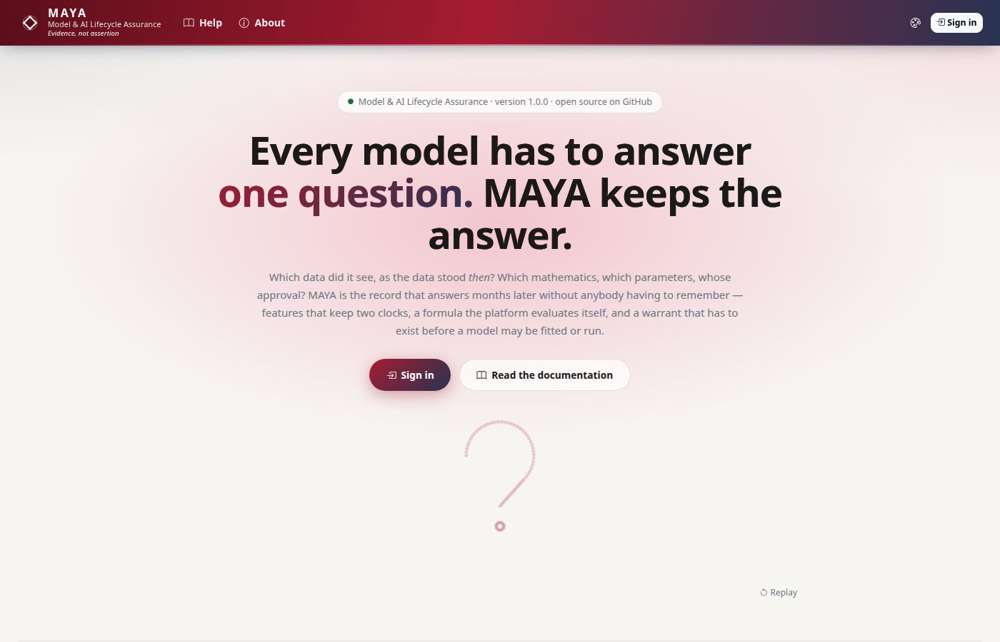
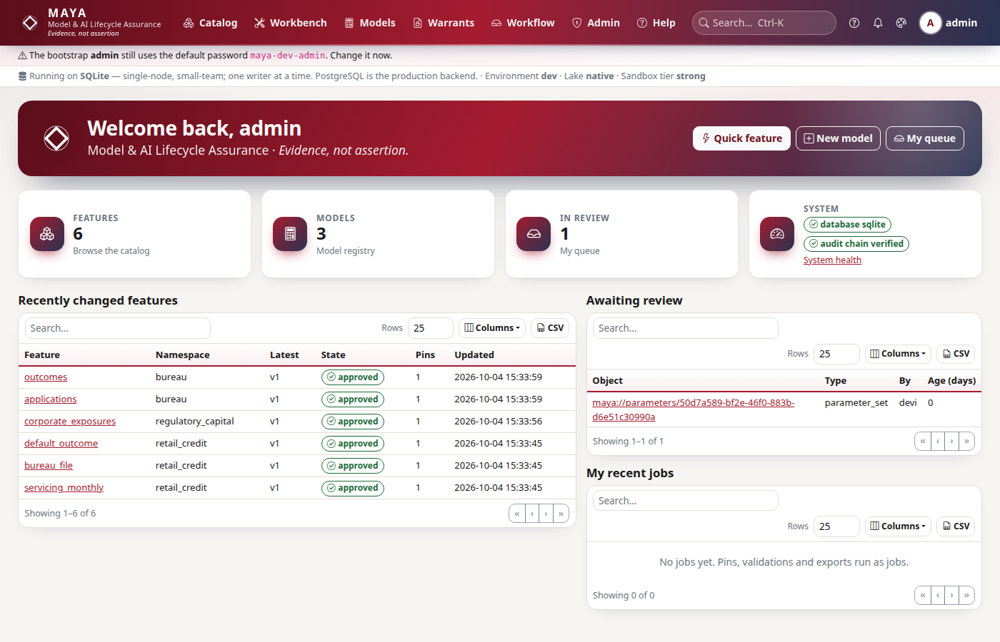

# Tutorial 1 · Your first 15 minutes

Start MAYA, sign in, set up the people who will work in it, and turn a CSV into
a feature you can search for, preview and share. All of this happens before
anything is governed. Afterwards you will know your way around the screens and
the Python SDK, and every later tutorial builds on what you set up here.

## Time to complete

15 minutes.

## Before you start

- MAYA installed, following the [quick start](/help/getting-started). That means
  Python 3.13 and `pip install -e ./sdk -r requirements.txt`.
- A terminal open at the repository's root.
- Nothing else. MAYA uses SQLite and local storage out of the box.

## What you will learn

- How to start MAYA, and where its landing page, dashboard and help are.
- Who does what in MAYA: designers write, managers approve, and nobody approves
  their own work.
- How to create people and a namespace, from the screen or from Python.
- How to turn a CSV into a feature in one call, and find it again.
- What "scratch" means: a feature you may try freely, which nothing governed can
  depend on.

## Step 1 · Start MAYA

```console
# Start the server: one process, SQLite, everything on this machine
python run_maya_web.py
```

You should see a banner, then a line saying where MAYA is serving:

```text
  Serving on http://127.0.0.1:8600, http://192.168.1.20:8600   (API docs: /api/v1/docs)
```

The first address is for this machine. The second is your network address, for a
phone or another computer on the same Wi-Fi. Leave this terminal running and open
a second terminal for the rest of the tutorial.

## Step 2 · Sign in and look around

Open `http://127.0.0.1:8600`. Signed out, that is the landing page: what MAYA is
for, and the chain it keeps. Click **Sign in** and sign in as `admin` with the
development password `maya-dev-admin`. MAYA warns you, in a banner on every page,
until you change it.



You should see your dashboard: quick actions, four tiles, recent changes, your
review queue and your jobs.



Three things are on every page:

- The **house** icon in the top bar returns you to this dashboard. The MAYA logo
  opens the landing page.
- The **?** icon jumps to *About this page* at the foot of the page: what the
  page is for, and a link to its guide.
- **Ctrl-K** (⌘K on a Mac) opens search.

## Step 3 · Create the people and a namespace

MAYA separates duties, so one person cannot carry a model from idea to
production alone. This tutorial needs two people: **dana**, a *feature designer*
who writes definitions and submits them, and **mick**, a *feature manager* who
reviews and approves. Later tutorials add more.

On screen, **Admin → Users** (`/admin/users`) creates users with their roles, and
**Admin → Namespaces** (`/admin/namespaces`) creates a namespace. A namespace is
the unit of ownership and policy, like a project or a desk. You can do the same
from Python. The helper below signs a person in and gives them an API key, which
each person would otherwise create under **Account → API keys**.

```python
# setup: the people, a namespace, and one SDK client per person
import os

import maya.sdk as maya

URL = os.environ.get("MAYA_URL", "http://127.0.0.1:8600")
PW = "Tutorial-pass-1"


def connect_as(user, password=PW):
    """Sign in, create an API key, and return a client acting as that person."""
    token = maya.Client(URL).auth.login(user, password)["token"]
    key = maya.Client(URL, token=token).auth.create_api_key("tutorial")["api_key"]
    return maya.connect(base_url=URL, api_key=key)


admin = connect_as("admin", "maya-dev-admin")  # your admin password, if you changed it
admin.admin.create_user("dana", password=PW, roles=["feature_designer"])
admin.admin.create_user("mick", password=PW, roles=["feature_manager"])
ns = admin.namespaces.create("eq", preset="standard")
print(ns["name"], ns["preset"], ns["production"])

dana, mick = connect_as("dana"), connect_as("mick")
print(dana.auth.me()["username"], dana.auth.me()["roles"])
```

You should see the namespace and dana's roles:

```text
eq standard False
dana ['feature_designer']
```

The `standard` preset means separation of duties: whoever submits a definition
cannot approve it.

## Step 4 · A feature in one call

Sometimes you just want to see your data in MAYA. A *quick feature* infers a
definition from a file and creates the feature in your **scratch** namespace,
your personal sandbox.

```python
# a CSV of daily closing prices, turned into a feature in one call
csv = (
    "date,symbol,close\n"
    "2026-01-05,AAA,100.0\n2026-01-05,BBB,50.0\n"
    "2026-01-06,AAA,101.5\n2026-01-06,BBB,50.5\n"
    "2026-01-07,AAA,101.0\n2026-01-07,BBB,50.8\n"
)
quick = dana.features.quick(csv.encode(), name="first_prices")
print(quick["ref"])
print(quick["schema"]["index"], [a["name"] for a in quick["schema"]["schema"]], quick["rows"])
```

You should see the feature's reference, in dana's scratch namespace
`scratch.dana`, and what MAYA inferred: `date` and `symbol` index each row,
`close` is the value, and six rows were loaded.

```text
maya://feature/scratch.dana/first_prices
['date', 'symbol'] ['close'] 6
```

The first index column is the **event time**, when each price was true. MAYA
records a second clock of its own: when it learned each value. Tutorial 3 is
about why that matters.

## Step 5 · Read it back

```python
# preview what MAYA resolves from it
pv = dana.features.preview(quick["ref"] + "@v1")
print(pv["total_rows"], pv["columns"])
for row in pv["rows"][:2]:
    print(row["date"][:10], row["symbol"], row["close"])
```

You should see six rows, and the extra `_knowledge_time` column, the second
clock:

```text
6 ['date', 'symbol', 'close', '_knowledge_time']
2026-01-05 AAA 100.0
2026-01-05 BBB 50.0
```

On screen the feature is at **Catalog → Features**, under `scratch.dana`.


## Step 6 · Find it, and see what scratch means

```python
# search finds it, for whoever may read it
hits = dana.access.search("first_prices")
print([(h["kind"], h["namespace"], h["name"]) for h in hits])

# scratch is ungoverned: nothing to approve, and nothing governed may read it
f = dana.features.get(quick["ref"])
print(f["namespace"], f["ungoverned"])
```

You should see the feature among the search results, and marked ungoverned:

```text
[('feature', 'scratch.dana', 'first_prices')]
scratch.dana True
```

Scratch is for trying things. To build on a feature, a feature set, a model or a
warrant, the feature has to live in a governed namespace like `eq`, with a
reviewed definition. That is tutorial 2.

## Next steps

- [Tutorial 2 · A governed feature](/help/guides/tutorial-02-a-governed-feature)
  takes a definition through review, approval and a sealed pin.
- The [tour of the screens](/help/getting-started#tour) shows each area of the UI.
- [Features](/help/features) explains every part of a feature definition.

## If something goes wrong

| What you see | Why | What to do |
|---|---|---|
| `Connection refused` from Python | MAYA is not running, or is on another port | Check the first terminal; set `MAYA_URL` if you started it on another port |
| `Invalid credentials` for `admin` | You changed the admin password in the browser | Pass your new password to `connect_as("admin", ...)` |
| `Conflict: user 'dana' already exists` | You ran step 3 before | Skip the `create_user` lines, or start from a fresh estate |
| `Could not find an event-time column` | The CSV has no date column | A quick feature needs a column named like `date`, `as_of` or `timestamp` |
