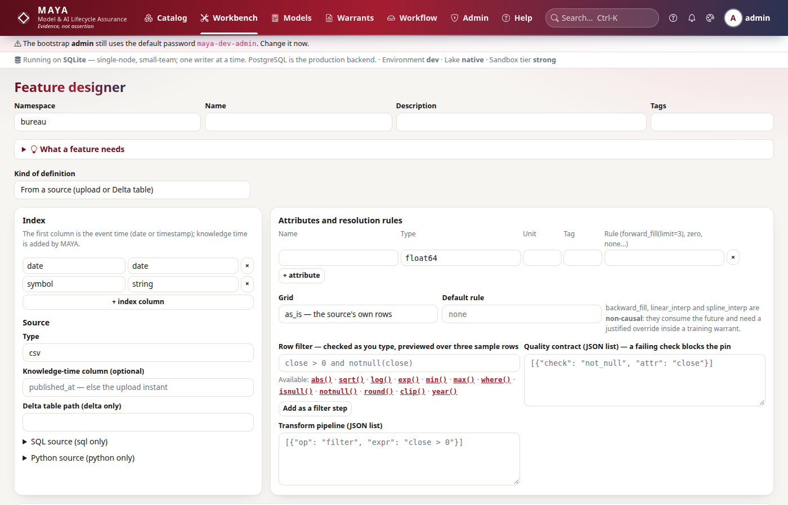
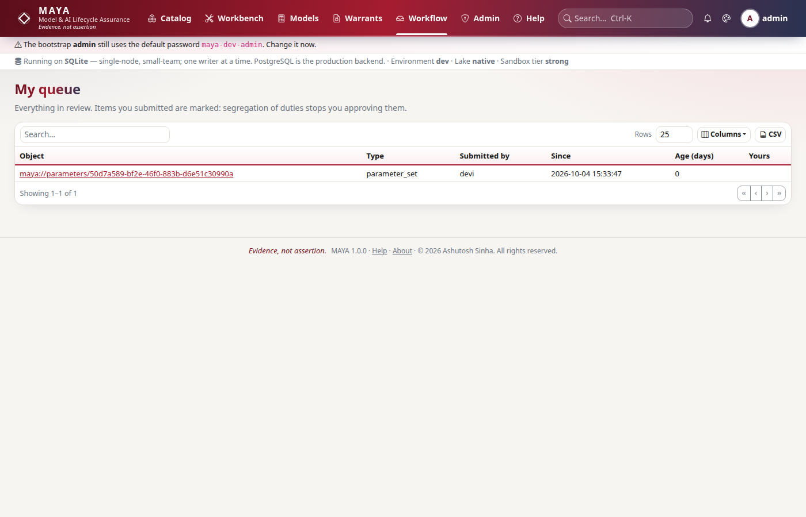
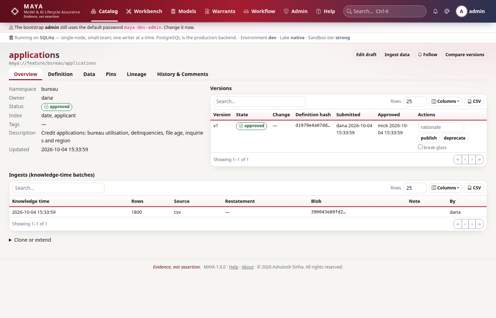

# Tutorial 2 · A governed feature

Take a CSV of daily closing prices from a file to a reviewed, approved and sealed
feature in the governed namespace `eq`. On the way MAYA fills a missing day and
says so, refuses to let the author approve their own work, and refuses to seal a
pin that breaks its quality contract. At the end you download the sealed pin as
a file that describes itself, from Python and from the command line.

## Time to complete

25 minutes.

## Before you start

- [Tutorial 1 · Your first 15 minutes](/help/guides/tutorial-01-first-15-minutes):
  MAYA running, the users **dana** (feature designer) and **mick** (feature
  manager), and the namespace `eq` with the `standard` preset.
- A terminal open in an empty working directory. The tutorial writes
  `prices.csv` and `prices-eom.csv` there.

## What you will learn

- What a full feature definition holds: the index, a schema with units, the
  source, a calendar grid, a bounded fill rule and quality checks.
- Why an ingest carries a knowledge time, and how to give the real one.
- How to preview a draft, and how to read the fill report.
- How review works: the designer submits, the manager approves, and the checks
  are shown on every move.
- Why a pin can fail, and what a sealed pin is.
- How to download a pin, and what the manifest in the file says.

## Step 1 · Reconnect

Every tutorial starts as a new session would. The helpers are the ones from
tutorial 1, split in two this time: `key_for` returns a person's API key, which
the command line needs in step 10, and `connect_as` wraps it in a client.

```python
# reconnect: the two people from tutorial 1
import os

import maya.sdk as maya

URL = os.environ.get("MAYA_URL", "http://127.0.0.1:8600")
PW = "Tutorial-pass-1"


def key_for(user, password=PW):
    """Sign in and create an API key for that person."""
    token = maya.Client(URL).auth.login(user, password)["token"]
    return maya.Client(URL, token=token).auth.create_api_key("tutorial")["api_key"]


def connect_as(user, password=PW):
    """Sign in, create an API key, and return a client acting as that person."""
    return maya.connect(base_url=URL, api_key=key_for(user, password))


dana, mick = connect_as("dana"), connect_as("mick")
print(dana.auth.me()["roles"], mick.auth.me()["roles"])
```

You should see each person's role:

```text
['feature_designer'] ['feature_manager']
```

## Step 2 · Write the definition

In tutorial 1 MAYA inferred a definition from the file. A governed feature has
one written out, because the definition is what a reviewer approves. This one
says:

- **index**: each row is one `date` and one `symbol`. The first index column is
  the event time.
- **schema**: one attribute, `close`, a float in US dollars.
- **source**: the data arrives as CSV uploads.
- **resolution**: the feature lies on the Monday-to-Friday calendar
  (`ISO_business_days`). A missing day is filled forward from the last price,
  but at most three days in a row (`limit=3`) and never from a price more than
  five days old (`max_age=5`). Beyond that the gap stays empty. An unbounded
  fill would quietly carry a stale price forward for months.
- **quality**: `close` is never null and never negative. These checks run
  before approval and before every pin.

```python
# dana writes the definition and creates the feature as a draft
definition = {
    "index": ["date", "symbol"],
    "index_types": {"date": "date", "symbol": "string"},
    "schema": [{"name": "close", "type": "float64", "unit": "USD"}],
    "source": {"type": "csv"},
    "resolution": {
        "grid": {"calendar": "ISO_business_days"},
        "rules": {"close": "forward_fill(limit=3, max_age=5)"},
    },
    "transform": [],
    "quality": [
        {"check": "not_null", "attr": "close"},
        {"check": "range", "attr": "close", "min": 0, "max": 100000},
    ],
}
f = dana.features.create("eq", "prices", definition, description="Daily closing prices")
print(f["name"], f["status"], f["ungoverned"])
```

You should see a draft, and governed this time:

```text
prices draft False
```

On screen the same form is **Workbench → Feature designer**
(`/workbench/features/new`). Every key is explained in the
[feature definition reference](/help/features#reference).



## Step 3 · Ingest with a real knowledge time

The vendor's file has four days for two symbols. Wednesday 7 January is
missing, which is the point: step 4 shows what the definition does about it.

The vendor published the file at 18:00 UTC on Friday 9 January. Tell MAYA so.
Without `knowledge_time`, MAYA stamps the moment of upload, which is the wrong
answer to "what did we know on 9 January?" if you load history a year later.

```python
# write the vendor's file, then ingest it with its publication time
with open("prices.csv", "w") as fh:
    fh.write(
        "date,symbol,close\n"
        "2026-01-05,AAA,100.0\n2026-01-05,BBB,50.0\n"
        "2026-01-06,AAA,101.5\n2026-01-06,BBB,50.5\n"
        "2026-01-08,AAA,102.0\n2026-01-08,BBB,51.0\n"
        "2026-01-09,AAA,103.0\n2026-01-09,BBB,51.2\n"
    )
with open("prices.csv", "rb") as fh:
    out = dana.features.ingest(
        "eq/prices",
        fh.read(),
        fmt="csv",
        filename="prices.csv",
        knowledge_time="2026-01-09T18:00:00Z",
    )
print(out["rows"], out["knowledge_time"], out["restatement"])
```

You should see eight rows, the knowledge time you gave, and that this is not a
restatement (nothing was known before it):

```text
8 2026-01-09T18:00:00+00:00 False
```

On screen this is the feature's **Ingest** page
(`/workbench/features/eq/prices/ingest`).

## Step 4 · Preview the draft and read the fill report

Before anyone reviews the definition, see what it does to the data. A draft
preview resolves it live: the grid, the rule and the knowledge-time cut.

```python
# resolve the draft as it stands
pv = dana.features.draft_preview("eq/prices")
print(pv["total_rows"], pv["columns"])
for row in pv["rows"][4:6]:
    print(row["date"][:10], row["symbol"], row["close"], row["_knowledge_time"])
report = pv["fill_report"]
print(report["source_rows"], report["first_gap"], report["last_gap"])
print(report["attributes"]["close"])
```

You should see ten rows from eight, the two new rows for 7 January carrying
6 January's prices and no knowledge time, and the fill report:

```text
10 ['date', 'symbol', 'close', '_knowledge_time']
2026-01-07 AAA 101.5 NaT
2026-01-07 BBB 50.5 NaT
8 2026-01-07 2026-01-07
{'rule': 'forward_fill(limit=3, max_age=5)', 'filled': 2, 'longest_run': 1, 'non_causal': False}
```

The calendar made 7 January exist, the rule filled it, and the report counts
what it did: two values filled, the longest run of filled days one, and the rule
reads only the past (`non_causal: False`). A filled value has no knowledge time
of its own, because nobody published it. Nothing in MAYA fills silently.

## Step 5 · Submit, and try to approve your own work

```python
# dana submits version 1 for review
r = dana.features.transition("eq/prices", 1, "submit")
print(r["state"], [(c["check"], c["passed"]) for c in r["checks"]])

# and tries to approve it herself
try:
    dana.features.transition("eq/prices", 1, "approve")
except maya.PermissionDenied as exc:
    print(type(exc).__name__, exc)
```

You should see the version in review, and the approval refused:

```text
in_review [('definition_valid', True)]
PermissionDenied You may not approve this object: role ceiling: no 'A' on feature in roles feature_designer
```

Submitting froze the definition, computed its hash, and put it in mick's queue
under **Workflow** (`/workflow`). The refusal names its reason: a feature
designer's role carries no approve right (`A`) on features. Even someone who
held both roles would be stopped here, by the `standard` preset's separation of
duties: whoever submitted cannot approve.

## Step 6 · The manager approves

```python
# mick reviews and approves, with a rationale for the record
r = mick.features.transition("eq/prices", 1, "approve", rationale="Checked against the vendor file")
print(r["state"])
for c in r["checks"]:
    print(" ", c["check"], c["passed"], "-", c["detail"])
```

You should see the version approved, and each check MAYA ran before allowing it:

```text
approved
  definition_valid True - definition is valid and typed
  quality_passes True - 2 quality check(s) pass on current data
  no_open_blocking_comments True - no open blocking comments
```

Any check that failed would have blocked the approval and been named in the
error. On screen mick opens the item from **Workflow**, reads the definition and
the preview, and presses **Approve**.



## Step 7 · A pin that fails its quality contract

A **pin** seals one resolution of the feature as immutable data, addressed by
its content hash, under a series name and an as-of date. Models train on pins,
not on live data, so what they saw can never change underneath them.

mick tries a month-end pin, as of 31 January:

```python
# a month-end pin; the job runs in the background, so wait for it
out = mick.features.pin("eq/prices", version_no=1, pin_name="eom", as_of="2026-01-31")
try:
    mick.wait(out["job"])
except maya.MayaError as exc:
    print(type(exc).__name__, exc)

pin = mick.features.get("eq/prices")["pins"][0]
print(pin["ref"], pin["state"])
print(pin["failure"])
```

You should see the job fail, and the pin record exactly why:

```text
MayaError Job feature.pin failed: QualityCheckFailed: Pin blocked by the quality contract
maya://feature/eq/prices#eom/2026-01-31 failed
quality check(s) failed: not_null(close): 24 null value(s)
```

The calendar grid runs to the pin's date, so every business day to 30 January
exists as a row. The data stops on 9 January. The fill carries Friday's price
over 12, 13 and 14 January and stops there: that is three filled days
(`limit=3`) and five days after the last price (`max_age=5`). The twelve
business days after that are null for both symbols, 24 values. `not_null`
fails, and a failing check blocks the pin. MAYA never warns and seals anyway. A
pin that would have trained a model on blanks is refused.

## Step 8 · A pin that seals

The data runs to 9 January, so pin as of 9 January. A failed series and date may
be reused, so the series is still `eom`:

```python
# pin as of the last day there is data for
out = mick.features.pin("eq/prices", version_no=1, pin_name="eom", as_of="2026-01-09")
result = mick.wait(out["job"])["result"]
print(result["rows"], result["content_hash"])
```

You should see ten rows sealed, and the pin's content hash:

```text
10 5d6539b3ad9d9a96585cadd95e9c0228a78528968c3a731e2626f471cac16bb2
```

The hash is computed from the rows themselves, so your hash matches this one if
your data does. That is the point: anyone holding the pin's reference can check
they hold the same data. The pin's reference is
`maya://feature/eq/prices#eom/2026-01-09`: the feature, then `#`, the series
and the date. On screen the pins are listed under **Catalog → Features →
eq/prices** (`/catalog/features/eq/prices`).



## Step 9 · Download it, with the manifest

```python
# download the sealed pin as CSV
d = mick.features.download("maya://feature/eq/prices#eom/2026-01-09", format="csv")
print(d["manifest"]["ref"], d["manifest"]["rows"], d["manifest"]["content_hash"][:12])
lines = d["data"].decode().splitlines()
print("\n".join(lines[:4]))
```

You should see the pin's reference, its rows and hash, then the file. Its first
line is a manifest naming every column's type, so the file describes itself:

```text
maya://feature/eq/prices#eom/2026-01-09 10 5d6539b3ad9d
# maya-manifest: {"axes": {}, "columns": {"_knowledge_time": "timestamp", "close": "float64", "date": "date", "symbol": "string"}, "encoding": null}
date,symbol,close,_knowledge_time
2026-01-05,AAA,100.0,2026-01-09 18:00:00+00:00
2026-01-05,BBB,50.0,2026-01-09 18:00:00+00:00
```

A CSV on its own loses types: is `20260105` a date or a number? The manifest
line answers that for whoever opens the file next. The download was audited:
who, what and when.

## Step 10 · The same from the command line

The command line is `python -m maya.cli`. It reads `MAYA_URL` and
`MAYA_API_KEY` from the environment. In real use each person keeps their own key
in `MAYA_API_KEY`. Here Python sets it for mick, and the shell inherits it:

```python
# the command line acts as whoever's key is in MAYA_API_KEY: here, mick
os.environ["MAYA_API_KEY"] = key_for("mick")
```

```bash
# list the namespace's features, download the pin, and seal a second series
python -m maya.cli feature list --namespace eq
python -m maya.cli feature download "maya://feature/eq/prices#eom/2026-01-09" \
    --out prices-eom.csv --format csv
python -m maya.cli feature pin eq/prices --version 1 --name daily --as-of 2026-01-08
```

You should see the feature with its one sealed pin, the download with the same
content hash as step 9, and a new pin sealed after the job's progress lines:

```text
REF                       LATEST_VERSION  LATEST_STATE  PINS  OWNER
maya://feature/eq/prices  1               approved      1     dana
prices-eom.csv: 10 rows, content hash 5d6539b3ad9d9a96585cadd95e9c0228a78528968c3a731e2626f471cac16bb2
   10% resolving
  100% resolving
sealed 9fe73eb8959265d6afdc8d6563ab38dc89c88c616853602461e20a2f28e01f87 (8 rows, 218 new bytes)
```

The `daily` pin as of 8 January has eight rows: four days for two symbols. Other
useful commands are `feature show` (everything about a feature, as JSON),
`feature upload` (an ingest, with `--knowledge-time`) and `feature diff` (two
versions compared).

## Next steps

- [Tutorial 3 · Two clocks and restatements](/help/guides/tutorial-03-two-clocks)
  corrects a price, reads the feature as it was known on a date, and shows why
  this pin does not move.
- [Features](/help/features) explains every part of a definition, and every
  fill rule.
- [Workflow](/help/workflow) explains review, checks and separation of duties.

## If something goes wrong

| What you see | Why | What to do |
|---|---|---|
| `Conflict: Feature 'eq/prices' already exists` | You ran step 2 before | Use another name, or start from a fresh estate |
| `NotApproved` on submit, naming `definition_valid` | The definition has an error, such as a rule naming an attribute not in the schema | Read the error: it names the key. Fix it with `dana.features.update_draft(...)` |
| `PermissionDenied` when mick submits or dana approves | Each role does its own half | dana submits; mick approves |
| `QualityCheckFailed` on a pin you expected to seal | The pin date is past the data, or the data breaks a check | Read the pin's `failure`; pin an earlier date, or fix the data and pin again |
| `python: command not found` in step 10 | The virtual environment is not active in this shell | Activate it, or use the full path to its `python` |
