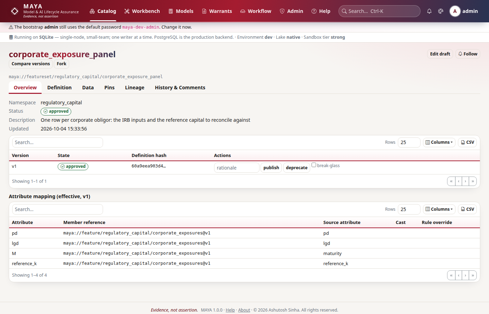

# Tutorial 4 · Feature sets and pins

A model does not read a feature. It reads a panel: one row per case, one column
per input, assembled from several features that were never designed to line up.
A **feature set** says how: which attribute of which feature feeds each column,
how the rows are aligned, and how any gap the join leaves is filled. In this
tutorial you build a small credit panel from two features, preview it, take it
through review, pin it together with its members, and download it.

## Time to complete

25 minutes.

## Before you start

- [Tutorial 1 · Your first 15 minutes](/help/guides/tutorial-01-first-15-minutes)
  and [Tutorial 2 · A governed feature](/help/guides/tutorial-02-a-governed-feature):
  MAYA running, with **dana** (feature designer) and **mick** (feature manager).
  [Tutorial 3](/help/guides/tutorial-03-two-clocks) explains the knowledge time
  each row carries here.
- The admin password, to add one person and one namespace.
- A terminal in a working directory. The tutorial writes `accounts.csv`,
  `bureau.csv`, `panel.csv` and `panel.parquet` there.

## What you will learn

- How to give every row its own knowledge time, from a column of the file.
- How a feature set maps feature attributes onto the names a model will read.
- How alignment decides the rows, and how a fill rule closes a gap the join left.
- How to preview a draft set, and how to read its manifest.
- Why a set can only pin over pinned members, and what a cascade pin seals.
- How to check what you may do with the data, and download the panel.

## Step 1 · Reconnect, and add a person and a namespace

The panel is credit data, so it gets its own namespace, `credit`, with the same
`standard` preset as `eq`. And it gets a new person: **devi**, a *model
developer*. Model developers build the feature sets models train on, and later
run the training. They may read features but not write them, and may not
approve a feature set.

```python
# reconnect; the admin adds devi and the credit namespace
import datetime as dt
import os

import maya.sdk as maya

URL = os.environ.get("MAYA_URL", "http://127.0.0.1:8600")
PW = "Tutorial-pass-1"


def key_for(user, password=PW):
    """Sign in and create an API key for that person."""
    token = maya.Client(URL).auth.login(user, password)["token"]
    return maya.Client(URL, token=token).auth.create_api_key("tutorial")["api_key"]


def connect_as(user, password=PW):
    """Sign in, create an API key, and return a client acting as that person."""
    return maya.connect(base_url=URL, api_key=key_for(user, password))


admin = connect_as("admin", "maya-dev-admin")  # your admin password, if you changed it
admin.admin.create_user("devi", password=PW, roles=["model_developer"])
ns = admin.namespaces.create("credit", preset="standard")
dana, mick, devi = connect_as("dana"), connect_as("mick"), connect_as("devi")
print(ns["name"], ns["preset"], devi.auth.me()["roles"])
```

You should see the namespace and devi's role:

```text
credit standard ['model_developer']
```

## Step 2 · Two features, each row with its own knowledge time

A lender keeps two monthly files for each account. The servicing system gives
**utilisation** (balance over limit) and **dti** (debt to income): one feature
with two attributes, `credit/accounts`. The credit bureau gives a
**bureau score**: `credit/bureau`. Both run from January to June 2026 for three
accounts. The bureau missed account C003 in April.

Neither file arrives on the day it describes. Servicing data lands five days
after month end, bureau scores ten. Each file has a `kt` column saying when
each row became known, and `knowledge_time_column` tells MAYA to use it. This is
better than one knowledge time per upload when a file carries history.

```python
# write the two monthly files: three accounts, six month ends
MONTHS = ["2026-01-31", "2026-02-28", "2026-03-31", "2026-04-30", "2026-05-31", "2026-06-30"]
ACCOUNTS = {"C001": (0.20, 0.25, 720), "C002": (0.55, 0.38, 655), "C003": (0.85, 0.47, 590)}


def known(month_end, days_later):
    day = dt.date.fromisoformat(month_end) + dt.timedelta(days=days_later)
    return f"{day}T08:00:00Z"


with open("accounts.csv", "w") as fh:
    fh.write("date,account,utilisation,dti,kt\n")
    for i, month in enumerate(MONTHS):
        for account, (util, dti, _) in ACCOUNTS.items():
            fh.write(f"{month},{account},{util + 0.01 * i:.2f},{dti:.2f},{known(month, 5)}\n")

with open("bureau.csv", "w") as fh:
    fh.write("date,account,bureau_score,kt\n")
    for i, month in enumerate(MONTHS):
        for account, (_, _, score) in ACCOUNTS.items():
            if (account, month) != ("C003", "2026-04-30"):  # the bureau missed C003 in April
                fh.write(f"{month},{account},{score - 2 * i},{known(month, 10)}\n")
```

The definitions follow tutorial 2's pattern. There is no calendar here: the
rows are month ends, kept as they come (`grid: as_is`).

```python
# dana defines both features and ingests them; mick approves
accounts = {
    "index": ["date", "account"],
    "index_types": {"date": "date", "account": "string"},
    "schema": [
        {"name": "utilisation", "type": "float64", "unit": "ratio"},
        {"name": "dti", "type": "float64", "unit": "ratio"},
    ],
    "source": {"type": "csv", "knowledge_time_column": "kt"},
    "resolution": {"grid": "as_is", "rules": {}},
    "transform": [],
    "quality": [
        {"check": "not_null", "attr": "utilisation"},
        {"check": "range", "attr": "utilisation", "min": 0, "max": 1.5},
        {"check": "range", "attr": "dti", "min": 0, "max": 1},
    ],
}
bureau = {
    "index": ["date", "account"],
    "index_types": {"date": "date", "account": "string"},
    "schema": [{"name": "bureau_score", "type": "float64", "unit": "points"}],
    "source": {"type": "csv", "knowledge_time_column": "kt"},
    "resolution": {"grid": "as_is", "rules": {}},
    "transform": [],
    "quality": [{"check": "range", "attr": "bureau_score", "min": 300, "max": 850}],
}
for name, definition in [("accounts", accounts), ("bureau", bureau)]:
    dana.features.create("credit", name, definition)
    with open(f"{name}.csv", "rb") as fh:
        rows = dana.features.ingest(f"credit/{name}", fh.read(), fmt="csv")["rows"]
    dana.features.transition(f"credit/{name}", 1, "submit")
    state = mick.features.transition(f"credit/{name}", 1, "approve")["state"]
    print(f"credit/{name}", rows, "rows", state)
```

You should see eighteen servicing rows, seventeen bureau rows (one missing),
and both approved:

```text
credit/accounts 18 rows approved
credit/bureau 17 rows approved
```

## Step 3 · Map the features into a feature set

The scorecard in tutorial 5 reads three inputs, called `utilisation`, `dti`
and `bureau`. The set's **members** map each of those names to an attribute of
a feature. Note the third: the model's `bureau` is the bureau feature's
`bureau_score`. The model's vocabulary and the data's need not match; the set
is where they meet.

Two more decisions:

- **Alignment.** `left` on `credit/accounts` means the servicing file decides
  the rows: every account it has, every month. The bureau is joined on to
  them. An `inner` join would silently drop C003's April, a row the lender
  certainly has.
- **Fill.** The join leaves C003's April bureau score empty. The member entry
  carries its own rule, `forward_fill(limit=1, max_age=31)`: carry last month's
  score for at most one month, and never from more than 31 days before. A
  score two months stale stays empty.

```python
# devi maps the attributes and creates the set as a draft
panel = {
    "index": ["date", "account"],
    "grid": "as_is",
    "alignment": {"mode": "left", "member": "maya://feature/credit/accounts@v1"},
    "members": [
        {
            "attr": "utilisation",
            "ref": "maya://feature/credit/accounts@v1",
            "source_attr": "utilisation",
        },
        {"attr": "dti", "ref": "maya://feature/credit/accounts@v1", "source_attr": "dti"},
        {
            "attr": "bureau",
            "ref": "maya://feature/credit/bureau@v1",
            "source_attr": "bureau_score",
            "rule": "forward_fill(limit=1, max_age=31)",
        },
    ],
}
fs = devi.featuresets.create("credit", "panel", panel, description="Monthly credit panel")
print(fs["name"], fs["status"])
```

You should see the set as a draft:

```text
panel draft
```

On screen this is **Workbench → Feature set builder**
(`/workbench/featuresets/new`), which offers each approved feature's
attributes to pick from.

## Step 4 · Preview the draft set

```python
# resolve the draft set live, and read its manifest
pv = devi.featuresets.draft_preview("credit/panel")
print(pv["total_rows"], pv["columns"])
for row in pv["rows"]:
    if row["account"] == "C003" and row["date"] >= "2026-03":
        print(" ", row["date"][:10], row["account"], row["bureau"])
manifest = pv["manifest"]
for attr, how in manifest["attributes"].items():
    print(attr, "<-", how["source_attr"], "|", how["rule"], "| layer:", how["layer"])
print(manifest["fill_report"]["bureau"])
```

You should see eighteen rows, C003's April filled from March (586), and for
each attribute where it came from and which rule filled it:

```text
18 ['date', 'account', 'utilisation', 'dti', 'bureau', '_knowledge_time']
  2026-03-31 C003 586.0
  2026-04-30 C003 586.0
  2026-05-31 C003 582.0
  2026-06-30 C003 580.0
utilisation <- utilisation | none | layer: default
dti <- dti | none | layer: default
bureau <- bureau_score | forward_fill(limit=1, max_age=31) | layer: attribute
{'rule': 'forward_fill(limit=1, max_age=31)', 'filled': 1, 'longest_run': 1, 'non_causal': False}
```

The `layer` says why each rule applies. A rule can come from the member entry
(`attribute`), a group policy, the set's global policy, a parent set, or the
member feature itself; with none, the gap is left empty (`default`). The
[feature set reference](/help/featuresets#reference) lists all six layers. A
reviewer reads this to see exactly which values were invented and on whose
authority.

## Step 5 · Review and approval

```python
# devi submits; devi cannot approve; mick approves
r = devi.featuresets.transition("credit/panel", 1, "submit")
print(r["state"])
try:
    devi.featuresets.transition("credit/panel", 1, "approve")
except maya.PermissionDenied as exc:
    print(type(exc).__name__, exc)
r = mick.featuresets.transition("credit/panel", 1, "approve", rationale="Mapping and fill checked")
print(r["state"])
for c in r["checks"]:
    print(" ", c["check"], c["passed"], "-", c["detail"])
```

You should see the set in review, devi refused, then approved with its checks:

```text
in_review
PermissionDenied You may not approve this object: role ceiling: no 'A' on featureset in roles model_developer
approved
  definition_valid True - definition is valid and typed
  members_approved True - all members approved or pinned
  no_open_blocking_comments True - no open blocking comments
```

`members_approved` is the check that matters here. A set over a draft feature
cannot be approved; the check would fail and name the draft. A governed set
stands only on governed data.



## Step 6 · A cascade pin

A model will train on this panel as of 30 June, so mick pins it. A plain pin is
refused:

```python
# a set pin over unpinned members
try:
    mick.featuresets.pin("credit/panel", version_no=1, pin_name="h1", as_of="2026-06-30")
except maya.NotApproved as exc:
    print(type(exc).__name__, exc)
```

You should see the refusal, naming both members:

```text
NotApproved A feature set refuses to pin unless every member is pinned. Unpinned: maya://feature/credit/accounts@v1, maya://feature/credit/bureau@v1. Use cascade pin to pin them together.
```

The members are referenced by version, and a version's data still moves: a
restatement changes what it resolves to. A sealed set over moving members would
not be sealed at all. With `cascade=True`, MAYA pins each member under the same
series and date, then the set over those pins, in one job. If any part fails,
the whole job is rolled back.

```python
# the cascade pin: members first, then the set over them
out = mick.featuresets.pin(
    "credit/panel", version_no=1, pin_name="h1", as_of="2026-06-30", cascade=True
)
result = mick.wait(out["job"])["result"]
print(result["rows"], "rows,", result["cascaded_member_pins"], "member pins")

pin = mick.featuresets.get("credit/panel")["pins"][0]
print(pin["ref"], pin["state"])
for member, member_pin in sorted(pin["manifest"]["member_pins"].items()):
    print(" ", member, "->", member_pin)
print(pin["manifest"]["plan"][0])
```

You should see the set sealed with eighteen rows, the two member pins it made,
and the set's plan reading from a sealed member pin rather than live data:

```text
18 rows, 2 member pins
maya://featureset/credit/panel#h1/2026-06-30 sealed
  maya://feature/credit/accounts@v1 -> maya://feature/credit/accounts#h1/2026-06-30
  maya://feature/credit/bureau@v1 -> maya://feature/credit/bureau#h1/2026-06-30
maya://feature/credit/accounts#h1/2026-06-30: read sealed pin (1 fragments)
```

So a cascade pin seals three things: each member's resolved data, and the set
assembled from exactly those. Each has its own content hash, and the set's pin
records its members' pins. Nothing it stands on can move.

## Step 7 · What you may do with it, and the download

Data comes with terms. A vendor may forbid redistribution, or limit retention.
MAYA works out the **effective licence** of anything built from features: the
strictest terms of everything underneath. Ask before you share:

```python
# the effective licence of the pin, then the panel as CSV
lic = devi.custody.licence("featureset", "maya://featureset/credit/panel#h1/2026-06-30")
print(lic["redistribution"], lic["derived_works"], lic["vendors"], lic["you_may_receive"])

d = devi.featuresets.download("maya://featureset/credit/panel#h1/2026-06-30", format="csv")
print(d["manifest"]["rows"], d["manifest"]["shape"], d["manifest"]["withheld"])
print("\n".join(d["data"].decode().splitlines()[1:3]))
```

You should see no restrictions (these files name no vendor terms), eighteen
rows in the tabular shape with nothing withheld, and the panel's header and
first row:

```text
public allowed [] True
18 tabular []
date,account,utilisation,dti,bureau,_knowledge_time
2026-01-31,C001,0.2,0.25,720.0,2026-02-10 08:00:00+00:00
```

Each row's `_knowledge_time` is the latest among the values it combines: the
bureau score, known ten days after month end. Had a member carried a vendor
licence, it would be listed here, and a download it forbids would be refused.

From the command line, as devi:

```python
# the command line acts as whoever's key is in MAYA_API_KEY: here, devi
os.environ["MAYA_API_KEY"] = key_for("devi")
```

```bash
# the same pin as CSV, and as Parquet for a notebook
python -m maya.cli featureset download "maya://featureset/credit/panel#h1/2026-06-30" \
    --out panel.csv --format csv
python -m maya.cli featureset download "maya://featureset/credit/panel#h1/2026-06-30" \
    --out panel.parquet
```

You should see both files written:

```text
panel.csv: 18 rows
panel.parquet: 18 rows
```

Parquet is the default: it keeps every type without a manifest line.

## Next steps

- [Tutorial 5 · Write a model](/help/guides/tutorial-05-write-a-model) writes
  the scorecard that will read this panel.
- [Feature sets](/help/featuresets) covers grids, as-of joins, group policies,
  filters and inheritance.
- [Access](/help/access#licences) explains licences and how they combine.

## If something goes wrong

| What you see | Why | What to do |
|---|---|---|
| `Conflict: user 'devi' already exists` | You ran step 1 before | Skip the `create_user` and `namespaces.create` lines |
| `members_approved` fails on approval | A member feature is still a draft or in review | Approve the member first; the check names it |
| `NotApproved ... Use cascade pin` | The members are not pinned | Pin with `cascade=True` |
| C003's April bureau score is empty | The fill rule is missing, or the gap is older than `max_age` | Check the member's `rule`, and the manifest's `layer` for `bureau` |
| `PermissionDenied` when devi creates a feature | A model developer reads features but does not write them | dana creates features; devi builds sets |
