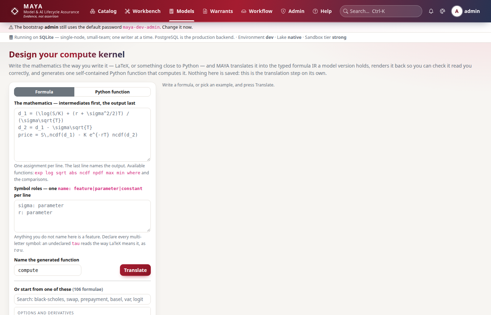
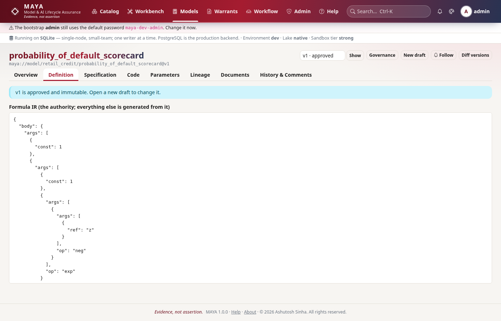
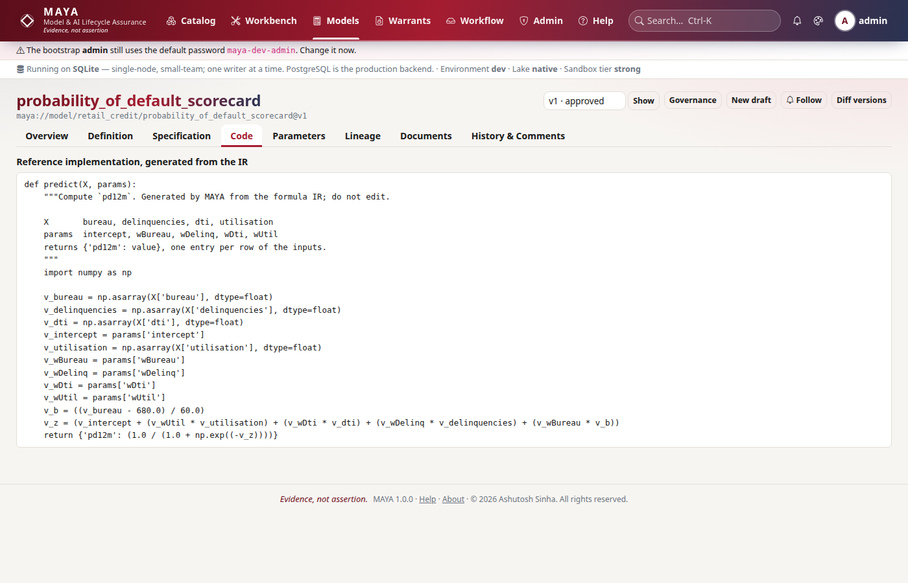

# Tutorial 5 · Write a model

In MAYA a model is mathematics, not a pickle. You write the formula the way you
would in a paper, in LaTeX or plain text, and MAYA turns it into a typed
expression tree, the **formula IR**. From that tree it renders the equations,
generates reference code, checks the inputs against a feature set, and tells a
reviewer what changed between versions. In this tutorial you write the credit
scorecard that will read the panel from tutorial 4: first in the compute-kernel
designer, to see what MAYA makes of your notation, then as a registered model.

## Time to complete

20 minutes.

## Before you start

- [Tutorial 4 · Feature sets and pins](/help/guides/tutorial-04-feature-sets-and-pins):
  the namespace `credit` and the approved feature set `credit/panel`, whose
  columns are `utilisation`, `dti` and `bureau`.
- [Tutorial 1](/help/guides/tutorial-01-first-15-minutes) created **dana**, a
  feature designer, who appears once here to be refused.
- The admin password, to add two people.

## What you will learn

- How to try a formula in the compute-kernel designer before anything is saved.
- Why LaTeX reads `xy` as x times y, and how declaring roles fixes it.
- How to register a model from LaTeX, and what its input contract is.
- What the generated reference code is for, and how to run it.
- That a cosmetic edit hashes the same, and a real change does not.
- How to lift a model from a Python function.
- Who may write, submit and approve a model.

## Step 1 · Reconnect, and add the model team

Models have their own separation of duties. **mona** is a *model designer*: she
writes models and their specifications. **mgr** is a *model manager*: he
approves them, and later approves training and execution. Neither can do the
other's half.

```python
# reconnect; the admin adds mona and mgr
import os

import maya.sdk as maya

URL = os.environ.get("MAYA_URL", "http://127.0.0.1:8600")
PW = "Tutorial-pass-1"


def connect_as(user, password=PW):
    """Sign in, create an API key, and return a client acting as that person."""
    token = maya.Client(URL).auth.login(user, password)["token"]
    key = maya.Client(URL, token=token).auth.create_api_key("tutorial")["api_key"]
    return maya.connect(base_url=URL, api_key=key)


admin = connect_as("admin", "maya-dev-admin")  # your admin password, if you changed it
admin.admin.create_user("mona", password=PW, roles=["model_designer"])
admin.admin.create_user("mgr", password=PW, roles=["model_manager"])
mona, mgr, dana = connect_as("mona"), connect_as("mgr"), connect_as("dana")
print(mona.auth.me()["roles"], mgr.auth.me()["roles"])
```

You should see their roles:

```text
['model_designer'] ['model_manager']
```

## Step 2 · Ask MAYA what it reads

The **compute-kernel designer** translates mathematics into the IR and into one
Python function, and saves nothing. Use it to check that MAYA read your notation
the way you meant it. Start with one line of the scorecard, naming the two
weights as parameters:

```python
# translate one line, without creating anything
first = mona.models.kernel(
    r"z = \beta_0 + \beta_1 \, utilisation",
    roles={"beta_0": "parameter", "beta_1": "parameter"},
)
print(first["latex"])
print([i["name"] for i in first["inputs"] if i["role"] == "feature"])
```

You should see `utilisation` read as eleven letters multiplied together, and
eight one-letter features:

```text
z = \beta_{0} + \beta_{1}\,u\,t\,i\,l\,i\,s\,a\,t\,i\,o\,n
['a', 'i', 'l', 'n', 'o', 's', 't', 'u']
```

That is the right reading of LaTeX, where `xy` means x times y, and the wrong
reading of what you meant. MAYA renders the equation back from the tree it
parsed, not from your text, so the misreading is visible before it costs
anything. A name MAYA has been told about is read as one symbol. So declare
every input's role, features as well as parameters.

On screen this is **Models → Design your compute kernel** (`/models/kernel`).



## Step 3 · Declare every role, and read it again

The scorecard in full. The bureau score is centred at 680 and scaled by 60, so
its weight is per 60 points. A linear score `z` combines the three drivers, and
the logistic function turns it into a probability of default:

```python
# the whole scorecard, with every input's role declared
tex = r"""
s = \frac{bureau - 680}{60}
z = \beta_0 + \beta_1 \, utilisation + \beta_2 \, dti + \beta_3 \, s
pd = \frac{1}{1 + e^{-z}}
"""
roles = {
    "utilisation": "feature",
    "dti": "feature",
    "bureau": "feature",
    "beta_0": "parameter",
    "beta_1": "parameter",
    "beta_2": "parameter",
    "beta_3": "parameter",
}
k = mona.models.kernel(tex, roles=roles, name="pd_scorecard")
print(k["latex"])
print("lets:", k["lets"], "output:", k["output"]["name"])
for i in k["inputs"]:
    print(" ", i["name"], i["role"])
```

You should see the equations rendered back correctly, the two intermediate
lines (*lets*) in evaluation order, the output, and seven inputs with their
roles:

```text
\begin{aligned}\mathit{pd} &= \frac{1}{1 + e^{-z}} \\ s &= \frac{\mathit{bureau} - 680}{60} \\ z &= \beta_{0} + \beta_{1}\,\mathit{utilisation} + \beta_{2}\,\mathit{dti} + \beta_{3}\,s\end{aligned}
lets: ['s', 'z'] output: pd
  beta0 parameter
  beta1 parameter
  beta2 parameter
  beta3 parameter
  bureau feature
  dti feature
  utilisation feature
```

`\beta_0` became the name `beta0`, and `e^{-z}` became the exponential. A
**feature** is a fact about each account, read from a feature set. A
**parameter** is a setting of the model, the same for every account, fitted in
training. Tutorial 6 is about the difference, and adds the third role,
**constant**.

## Step 4 · Register the model

The translation is right, so create the model. Creating runs the same parser,
so the result is the same tree:

```python
# mona registers the scorecard; version 1 starts as a draft
m = mona.models.create(
    "credit", "pd", formula=tex, roles=roles, description="12-month probability of default"
)
v = mona.models.get("credit/pd")["versions"][0]
print(m["kind"], "v" + str(v["version_no"]), v["state"], v["maturity"])
print("same tree as the designer:", v["ir_hash"] == k["ir_hash"])

contract = [c["name"] for c in v["input_contract"]]
panel = mona.featuresets.get("credit/panel")["versions"][0]["definition"]
print("input contract:", contract)
print("panel columns: ", sorted(member["attr"] for member in panel["members"]))
```

You should see a draft formula model at the `experimental` maturity, the same
IR hash as the designer's, and an input contract the panel meets exactly:

```text
formula v1 draft experimental
same tree as the designer: True
input contract: ['bureau', 'dti', 'utilisation']
panel columns:  ['bureau', 'dti', 'utilisation']
```

The **input contract** is the list of features any data bound to the model must
supply, with their types. Nobody wrote it: it falls out of the formula. When a
training warrant binds this model to `credit/panel`, MAYA checks the contract
against the set, and refuses a set that lacks a column.

On screen: **Models → New model** (`/models/new`), and the model's page,
`/models/credit/pd`, shows the equations, the IR and the contract.



## Step 5 · The reference code

MAYA generates plain Python from the IR. It is the yardstick: an
implementation of the model, written by anyone in any style, is tested against
it (tutorial 6 does that). It is also ordinary code you can run:

```python
# fetch the generated reference implementation, and run it on two accounts
src = mona.models.reference_code("credit/pd", 1)["source"]
print(src)

reference = {}
exec(src, reference)
X = {"utilisation": [0.20, 0.85], "dti": [0.25, 0.47], "bureau": [720, 590]}
example = {"beta0": -4.0, "beta1": 2.0, "beta2": 1.5, "beta3": -0.8}  # illustrative weights
print([round(float(p), 4) for p in reference["predict"](X, example)["pd"]])
```

You should see the generated function, then the two accounts' PDs under the
illustrative weights, about 2% for the careful borrower and 40% for the
stretched one:

```text
def predict(X, params):
    """Compute `pd`. Generated by MAYA from the formula IR; do not edit.

    X       bureau, dti, utilisation
    params  beta0, beta1, beta2, beta3
    returns {'pd': value}, one entry per row of the inputs.
    """
    import numpy as np

    v_beta0 = params['beta0']
    v_beta1 = params['beta1']
    v_beta2 = params['beta2']
    v_beta3 = params['beta3']
    v_bureau = np.asarray(X['bureau'], dtype=float)
    v_dti = np.asarray(X['dti'], dtype=float)
    v_utilisation = np.asarray(X['utilisation'], dtype=float)
    v_s = ((v_bureau - 680.0) / 60.0)
    v_z = (v_beta0 + (v_beta1 * v_utilisation) + (v_beta2 * v_dti) + (v_beta3 * v_s))
    return {'pd': (1.0 / (1.0 + np.exp((-v_z))))}

[0.0228, 0.4025]
```

The features come from `X`, one value per account; the parameters from
`params`, one value for all. The weights here are made up. Real ones come from
training under a warrant, later in the series.



## Step 6 · A cosmetic edit hashes the same

The IR hash is taken over the tree, not the text, so writing the same
mathematics differently is not a change. Write the scorecard in plain text
instead of LaTeX, and then make a real change, centring the score at 650:

```python
# the same mathematics in plain text, and a genuine change
plain = """
s = (bureau - 680) / 60
z = beta_0 + beta_1*utilisation + beta_2*dti + beta_3*s
pd = 1 / (1 + exp(-z))
"""
print("plain text, same hash:", mona.models.kernel(plain, roles=roles)["ir_hash"] == v["ir_hash"])
moved = tex.replace("680", "650")
print(
    "centred at 650, same hash:", mona.models.kernel(moved, roles=roles)["ir_hash"] == v["ir_hash"]
)
```

You should see the plain-text version hash identically, and the real change
not:

```text
plain text, same hash: True
centred at 650, same hash: False
```

This is what makes a version history trustworthy. Reformatting an equation
does not look like a change to the model, so it cannot hide one either. Between
two versions MAYA goes further and names each change in words, such as "let
'z' changed" or "parameter 'beta3' bounds changed"; tutorial 6 ends with one.

## Step 7 · A model from Python

Some modellers think in code. A Python function whose body is assignments and
one `return` can be lifted into the same IR. Names read from `params[...]` become
parameters, names read from `X[...]` become features, and `numpy` calls map to
IR operators:

```python
# lift the scorecard from a Python function
source = """
import numpy as np


def predict(X, params):
    s = (X["bureau"] - 680) / 60
    z = params["beta0"] + params["beta1"] * X["utilisation"] + params["beta2"] * X["dti"] + params["beta3"] * s
    return 1 / (1 + np.exp(-z))
"""
lifted = mona.models.kernel(python_source=source)
print(lifted["latex"])
print([(i["name"], i["role"]) for i in lifted["inputs"]])
mona.models.create("credit", "pd_lifted", python_source=source)
print(mona.models.get("credit/pd_lifted")["versions"][0]["state"])
```

You should see the same equations, with the output named `y`, the same seven
inputs with their roles taken from the code, and a second draft model:

```text
\begin{aligned}y &= \frac{1}{1 + e^{-z}} \\ s &= \frac{\mathit{bureau} - 680}{60} \\ z &= \beta_{0} + \beta_{1}\,\mathit{utilisation} + \beta_{2}\,\mathit{dti} + \beta_{3}\,s\end{aligned}
[('beta0', 'parameter'), ('beta1', 'parameter'), ('beta2', 'parameter'), ('beta3', 'parameter'), ('bureau', 'feature'), ('dti', 'feature'), ('utilisation', 'feature')]
draft
```

A returned expression has no name of its own, so the lifted output is called
`y`. Loops, branches and unknown calls are refused with the line named, never
approximated.

## Step 8 · Who may write, submit and approve

```python
# a feature designer may not create a model
try:
    dana.models.create("credit", "pd_dana", formula=tex, roles=roles)
except maya.PermissionDenied as exc:
    print(type(exc).__name__, exc)

# mona may submit, but not yet: the specification is empty
try:
    mona.models.transition("credit/pd", 1, "submit")
except maya.NotApproved as exc:
    print(type(exc).__name__, exc)
```

You should see dana refused by her role, and mona's submission blocked by a
named check:

```text
PermissionDenied You may not create model 'pd_dana': role ceiling: no 'C' on model in roles feature_designer
NotApproved Blocked by check(s): spec_document_complete — required sections empty: Purpose, Scope and Limitations, Assumptions, Calibration Methodology, Validation Evidence, Known Weaknesses, Change Log
```

So: a model designer creates and submits, a model manager approves, and a
feature designer reads models but does not write them. The submission is blocked because every model version carries a written
specification, and this one is still the empty template. Tutorial 6 fills it
in.

## Next steps

- [Tutorial 6 · Features, parameters, constants and the specification](/help/guides/tutorial-06-inputs-and-specification)
  gives the inputs values and bounds, completes the specification, attaches an
  implementation, and takes the model through approval.
- [Models](/help/models) covers formulas, lifting from Python and Excel, and
  models with no closed form.

## If something goes wrong

| What you see | Why | What to do |
|---|---|---|
| A word read as single letters (`u\,t\,i\,l...`) | In LaTeX, adjacent letters multiply | Declare the name's role, or write plain text without backslashes or braces |
| `unsupported LaTeX command '\mathit'` | The parser reads a subset of LaTeX; `\mathit` and `\text` are not in it | Write the bare name and declare its role |
| `Conflict: Model 'credit/pd' already exists` | You ran step 4 before | Use another name, or start from a fresh estate |
| `PermissionDenied ... no 'C' on model` | Only a model designer (or an admin) creates models | Create it as mona |
| Submission blocked by `spec_document_complete` | The specification's required sections are empty | Tutorial 6, step 4 |
