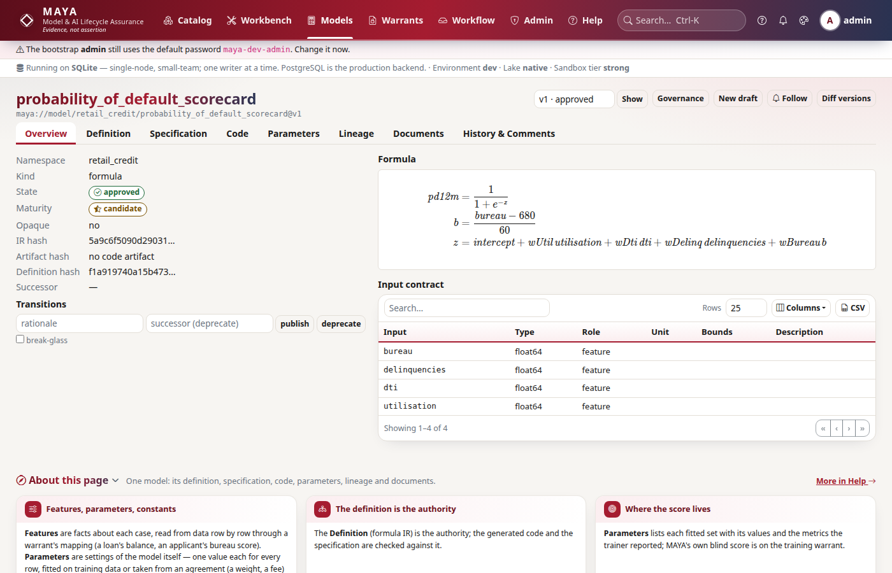

# Tutorial 6 · Features, parameters, constants and the specification

Every input of a model has a role, and the role says where its value comes from.
Get the roles right and the rest of MAYA follows: the feature set supplies the
features, training supplies the parameters, and the model itself carries its
constants. In this tutorial you give the scorecard from tutorial 5 named
constants, bounds on its parameters and a constraint across them, write its
specification, attach an implementation and test it against the mathematics,
and take the model through approval. It ends with a second version and the
semantic diff a reviewer reads.

## Time to complete

30 minutes.

## Before you start

- [Tutorial 5 · Write a model](/help/guides/tutorial-05-write-a-model): the draft
  model `credit/pd`, written by **mona** (model designer), and **mgr** (model
  manager).
- [Tutorial 4](/help/guides/tutorial-04-feature-sets-and-pins): the feature set
  `credit/panel`, used here to test the implementation on realistic values.

## What you will learn

- The three input roles, **feature**, **parameter** and **constant**, and where
  each value comes from.
- How to name a constant and give it a value.
- How to bound a parameter, and how to declare a constraint that bounds alone
  cannot express.
- What the specification document must contain, and why an incomplete one
  blocks submission.
- How an implementation is checked against the mathematics, and why the test
  domain matters.
- How approval works for a model, and how to read the semantic diff between two
  versions.

## Step 1 · Reconnect, and sort the inputs by role

```python
# reconnect, and list the scorecard's inputs by role
import os

import maya.sdk as maya

URL = os.environ.get("MAYA_URL", "http://127.0.0.1:8600")
PW = "Tutorial-pass-1"


def key_for(user, password=PW):
    """Sign in and create an API key for that person."""
    token = maya.Client(URL).auth.login(user, password)["token"]
    return maya.Client(URL, token=token).auth.create_api_key("tutorial")["api_key"]


def connect_as(user, password=PW):
    """Sign in, create an API key, and return a client acting as that person."""
    return maya.connect(base_url=URL, api_key=key_for(user, password))


mona, mgr = connect_as("mona"), connect_as("mgr")


def by_role(ir):
    roles = {}
    for i in ir["inputs"]:
        roles.setdefault(i["role"], []).append(i["name"])
    return roles


v1 = mona.models.get("credit/pd")["versions"][0]
print(by_role(v1["formula_ir"]))
```

You should see three features and four parameters:

```text
{'parameter': ['beta0', 'beta1', 'beta2', 'beta3'], 'feature': ['bureau', 'dti', 'utilisation']}
```

The two roles fail differently, so MAYA keeps them apart:

| Role | What it is | Where its value comes from | What protects it |
|---|---|---|---|
| **feature** | a fact about each case, one value per row: this account's utilisation | a column of a feature set, mapped by a warrant | quality checks, two clocks, pins |
| **parameter** | a setting of the model, one value for every row: the weight on utilisation | fitted in training, uploaded as a parameter set, approved | bounds, constraints, blind scoring, approval |
| **constant** | a number fixed by the model's design, not learned | written into the model version | review, and a new version to change it |

A wrong feature is bad data. A wrong parameter is a bad model. Keeping them
apart is also what lets one approved model run unchanged on next month's data:
only the features change.

## Step 2 · Name the constants

The scorecard centres the bureau score at 680 and scales it by 60. As bare
numbers in the formula they are anonymous: the specification cannot talk about
them, and nothing says they are a design choice rather than a typo. Name them
`\mu` and `\sigma`, give them the role **constant**, and give each its value:

```python
# rewrite the formula with named constants, then give the constants their values
tex = r"""
s = \frac{bureau - \mu}{\sigma}
z = \beta_0 + \beta_1 \, utilisation + \beta_2 \, dti + \beta_3 \, s
pd = \frac{1}{1 + e^{-z}}
"""
roles = {
    "utilisation": "feature",
    "dti": "feature",
    "bureau": "feature",
    "mu": "constant",
    "sigma": "constant",
    "beta_0": "parameter",
    "beta_1": "parameter",
    "beta_2": "parameter",
    "beta_3": "parameter",
}
CONSTANTS = {"mu": 680.0, "sigma": 60.0}


def give_values(ir):
    for i in ir["inputs"]:
        if i["name"] in CONSTANTS:
            i["value"] = CONSTANTS[i["name"]]
    return ir


mona.models.update_draft("credit/pd", formula=tex, roles=roles)
ir = mona.models.get("credit/pd")["versions"][0]["formula_ir"]
mona.models.update_draft("credit/pd", ir=give_values(ir))

v = mona.models.get("credit/pd")["versions"][0]
print(by_role(v["formula_ir"]))
print([(i["name"], i["value"]) for i in v["formula_ir"]["inputs"] if i["role"] == "constant"])
print([c["name"] for c in v["input_contract"]])
```

You should see the two constants with their values, and the input contract
unchanged: constants are not data, so no feature set has to supply them:

```text
{'parameter': ['beta0', 'beta1', 'beta2', 'beta3'], 'feature': ['bureau', 'dti', 'utilisation'], 'constant': ['mu', 'sigma']}
[('mu', 680.0), ('sigma', 60.0)]
['bureau', 'dti', 'utilisation']
```

The formula is written in LaTeX; the values, like the bounds in the next step,
are declared on the IR that MAYA derived from it. That is why there are two
calls: one to write the mathematics, one to declare facts about its inputs.

## Step 3 · Bounds, and a constraint bounds cannot express

A parameter fitted outside the range that makes sense is a bad model, however
good its fit. Declare the range on each parameter:

- `beta1` and `beta2` in [0, 10]: more utilisation or more debt can never
  lower the PD.
- `beta3` in [−5, 0]: a better bureau score can never raise it.
- `beta0` in [−10, 2].

Some conditions involve several parameters at once. Regulators set a **PD
floor**: no account may be given a PD below 0.05%. The best possible applicant
has utilisation 0, DTI 0 and a score of 850, so `s` = (850 − 680) / 60 ≈ 2.8333
and `z` = `beta0` + 2.8333 · `beta3`. The floor is `z` ≥ logit(0.0005) ≈ −7.6.
Each of `beta0` and `beta3` can sit inside its bounds while the pair breaks it.
That is a **constraint**, declared on the model with the reason in words:

```python
# per-parameter bounds, and the PD floor as a joint constraint
BOUNDS = {"beta0": [-10, 2], "beta1": [0, 10], "beta2": [0, 10], "beta3": [-5, 0]}
PD_FLOOR = {
    "expr": {
        "op": "add",
        "args": [
            {"param": "beta0"},
            {"op": "mul", "args": [{"const": 2.8333}, {"param": "beta3"}]},
        ],
    },
    "op": "ge",
    "rhs": -7.6,
    "why": "PD floor of 0.05%: even the best applicant (utilisation 0, DTI 0, score 850) "
    "may not be given a lower PD",
}


def give_bounds(ir):
    for i in ir["inputs"]:
        if i["name"] in BOUNDS:
            i["bounds"] = BOUNDS[i["name"]]
    ir["constraints"] = [PD_FLOOR]
    return ir


# a constraint may only read parameters: this one reads a feature, and is refused
ir = mona.models.get("credit/pd")["versions"][0]["formula_ir"]
wrong = dict(PD_FLOOR, expr={"op": "add", "args": [{"param": "beta0"}, {"ref": "dti"}]})
try:
    mona.models.update_draft("credit/pd", ir=dict(ir, constraints=[wrong]))
except maya.ValidationFailed as exc:
    print(type(exc).__name__, exc)

mona.models.get("credit/pd")
mona.models.update_draft("credit/pd", ir=give_bounds(ir))
v = mona.models.get("credit/pd")["versions"][0]
print([(i["name"], i["bounds"]) for i in v["formula_ir"]["inputs"] if i["role"] == "parameter"])
print(len(v["formula_ir"]["constraints"]), "constraint:", v["formula_ir"]["constraints"][0]["why"])
```

You should see the bad constraint refused with the reason, then the bounds and
the constraint stored:

```text
ValidationFailed The formula IR is not valid: constraints[0].expr reads dti: a constraint is over parameters alone, because it must hold before any data is seen
[('beta0', [-10, 2]), ('beta1', [0, 10]), ('beta2', [0, 10]), ('beta3', [-5, 0])]
1 constraint: PD floor of 0.05%: even the best applicant (utilisation 0, DTI 0, score 850) may not be given a lower PD
```

The constraint is written as a small expression tree over `{"param": ...}`
nodes, because it must hold before any data is seen. Bounds and constraints are
enforced when parameters arrive: a parameter set uploaded against a training
warrant is checked against both, and one that breaks either cannot be
submitted. The error quotes the `why`.

## Step 4 · The specification blocks submission

Every model version carries a **specification**: a LaTeX document a validator
can read without reading code. MAYA seeded one from a template when the model
was created. Try to submit with it untouched:

```python
# submit with the template specification
try:
    mona.models.transition("credit/pd", 1, "submit")
except maya.NotApproved as exc:
    print(type(exc).__name__, exc)

spec = mona.models.get("credit/pd")["versions"][0]["spec_latex"]
print([line for line in spec.splitlines() if line.startswith("\\section")])
```

You should see the submission blocked, naming every empty section, and noting
that the document must be saved again because the formula changed under it;
then the nine required sections:

```text
NotApproved Blocked by check(s): spec_document_complete — required sections empty: Purpose, Scope and Limitations, Assumptions, Calibration Methodology, Validation Evidence, Known Weaknesses, Change Log, (document marked for re-review after an IR change — save it)
['\\section{Purpose}', '\\section{Scope and Limitations}', '\\section{Mathematical Formulation}', '\\section{Assumptions}', '\\section{Data and Features Used}', '\\section{Calibration Methodology}', '\\section{Validation Evidence}', '\\section{Known Weaknesses}', '\\section{Change Log}']
```

The template filled two sections itself. *Mathematical Formulation* holds
`\mayaformula{body}`, which renders the equations from the IR, so the document
cannot disagree with the model. *Data and Features Used* lists the features.
The rest only a person can write. The specification is also bound to the IR it
was saved against: steps 2 and 3 changed the IR, so it is marked for re-review
until someone saves it again. The prose cannot silently drift from the
mathematics.

## Step 5 · An implementation, tested against the mathematics

The formula says what the model computes. An **implementation** is the code
that fits and runs it, written by a person and possibly wrong. MAYA validates an
uploaded implementation (it parses, has the right entry point, imports only
allowed modules, does nothing dangerous, runs in a sandbox), then compares its
output with the reference code on sampled inputs.

Here is mona's first attempt. It centres the score at 700, not 680:

```python
# an implementation: a class Model with fit and predict
implementation = '''
import numpy as np


class Model:
    """The scorecard: logistic regression fitted by Newton's method."""

    def _design(self, X):
        score = (np.asarray(X["bureau"], dtype=float) - 700.0) / 60.0
        cols = [np.asarray(X["utilisation"], dtype=float), np.asarray(X["dti"], dtype=float)]
        return np.column_stack([np.ones_like(score)] + cols + [score])

    def fit(self, X, y, ctx):
        A, t = self._design(X), np.asarray(y, dtype=float)
        b = np.zeros(A.shape[1])
        for _ in range(25):
            p = 1.0 / (1.0 + np.exp(-A @ b))
            H = A.T @ (A * (p * (1 - p))[:, None]) + 1e-6 * np.eye(A.shape[1])
            b = b + np.linalg.solve(H, A.T @ (t - p))
        return {"beta0": b[0], "beta1": b[1], "beta2": b[2], "beta3": b[3]}

    def predict(self, X, params, ctx):
        b = np.array([params["beta0"], params["beta1"], params["beta2"], params["beta3"]])
        return {"pd": 1.0 / (1.0 + np.exp(-self._design(X) @ b))}
'''
mona.models.get("credit/pd")
out = mona.models.upload_artifact("credit/pd", implementation)
print("validated:", mona.wait(out["job"]["id"])["result"]["passed"])
report = mona.models.get("credit/pd")["versions"][0]["artifact_report"]["conformance"]
print(report["agreed"], "of", report["total"], "-", report["domain"])

panel = "maya://featureset/credit/panel@v1"
check = mona.models.conformance("credit/pd", 1, n=200, featureset=panel)
print(check["agreed"], "of", check["total"], "-", check["domain"])
```

You should see the code validated, agreeing on every input drawn from the unit
interval, and disagreeing on every input drawn from the panel:

```text
validated: True
2000 of 2000 - drawn from the unit interval: no feature set was named, so agreement here says nothing about the values the model will really be given
0 of 200 - resampled from maya://featureset/credit/panel@v1 (18 rows)
```

The first test fed bureau scores between 0 and 1. At such scores every PD is
1.0 to nine decimal places, whatever the centre, so the bug could not show. MAYA
says so in the `domain`. Drawn from the panel's real values, the bug shows on
every row. Always test on the values the model will really be given.

Fix the centre, upload again, and test on the panel:

```python
# the corrected implementation, tested on the panel's values
implementation = implementation.replace("700.0", "680.0")
mona.models.get("credit/pd")
out = mona.models.upload_artifact("credit/pd", implementation)
print("validated:", mona.wait(out["job"]["id"])["result"]["passed"])
check = mona.models.conformance("credit/pd", 1, n=200, featureset=panel)
print(check["agreed"], "of", check["total"], "-", check["domain"])
print(check["statement"])
```

You should see full agreement on the panel's values, and MAYA's careful
statement of what that means:

```text
validated: True
200 of 200 - resampled from maya://featureset/credit/panel@v1 (18 rows)
Sampled agreement is not proof: the implementation agreed with the documented mathematics on 200 of 200 sampled inputs to a relative tolerance of 1e-09.
```

The test supplied the constants as `mu` = 680 and `sigma` = 60, from their
declared values, and placed each parameter inside its bounds.


## Step 6 · Complete the specification, and submit

Write each required section. Keep `\mayaformula{body}` where the equations go.
In practice you would keep this file next to your code; here Python writes it:

```python
# the completed specification
spec = r"""\documentclass[11pt]{article}
\usepackage{amsmath,amssymb}
\title{Retail 12-month PD scorecard}
\author{mona}
\begin{document}
\maketitle
\section{Purpose}
Estimate each revolving account's probability of default within twelve months,
for credit limit setting.
\section{Scope and Limitations}
Unsecured revolving accounts with a bureau score between 300 and 850. Not for
secured lending, small business or accounts under three months on book.
\section{Mathematical Formulation}
\mayaformula{body}
\section{Assumptions}
The log-odds of default are linear in utilisation, debt to income and the
bureau score centred at $\mu = 680$ and scaled by $\sigma = 60$.
\section{Data and Features Used}
The attributes utilisation, dti and bureau of maya://featureset/credit/panel,
monthly by account. The bureau score is carried forward at most one month.
\section{Calibration Methodology}
Maximum likelihood (logistic regression) on the training split of a training
warrant's pinned data. $\beta_1, \beta_2 \ge 0$ and $\beta_3 \le 0$; the
fitted PD may not fall below the 0.05\% floor.
\section{Validation Evidence}
Blind AUC and calibration by score band on the escrowed holdout, recorded on
the training warrant.
\section{Known Weaknesses}
No macroeconomic term, so the PD is through the cycle; the bureau score's
own model is outside this document.
\section{Change Log}
v1: first version.
\end{document}
"""
with open("pd_spec.tex", "w") as fh:
    fh.write(spec)

mona.models.get("credit/pd")
with open("pd_spec.tex") as fh:
    mona.models.update_draft("credit/pd", spec_latex=fh.read())
r = mona.models.transition("credit/pd", 1, "submit")
print(r["state"])
for c in r["checks"]:
    print(" ", c["check"], c["passed"], "-", c["detail"][:70])
```

You should see the version in review, and the four checks a submission runs:

```text
in_review
  formula_typechecks True - IR validates and typechecks
  spec_document_complete True - all required sections present
  code_artifact_validated True - validated under sandbox tier 'strong'
  code_matches_specification True - agreed with the specification on all 200 sampled inputs, resampled fro
```

`code_matches_specification` reads the most recent conformance test, which was
run on the panel. Had the implementation still disagreed, the submission would
have been blocked with a counterexample. A formula-only model, with no
implementation attached, passes the two code checks by saying so.

## Step 7 · Approval

```python
# mona cannot approve; mgr can
try:
    mona.models.transition("credit/pd", 1, "approve")
except maya.PermissionDenied as exc:
    print(type(exc).__name__, exc)

r = mgr.models.transition(
    "credit/pd", 1, "approve", rationale="Roles, bounds, floor and spec reviewed"
)
print(r["state"])
for c in r["checks"]:
    print(" ", c["check"], c["passed"])
print("maturity:", mgr.models.get("credit/pd")["versions"][0]["maturity"])
```

You should see mona refused, then the approval with every check, and the
maturity raised:

```text
PermissionDenied You may not approve this object: role ceiling: no 'A' on model in roles model_designer
approved
  formula_typechecks True
  spec_document_complete True
  code_artifact_validated True
  code_matches_specification True
  spec_true_build True
  composite_members_mature True
  no_open_blocking_comments True
maturity: candidate
```

Approval moved the model from `experimental` to `candidate`. `spec_true_build`
passed because this is a development estate: elsewhere the specification must
also build as a real PDF (`mona.models.render_spec("credit/pd", 1)`) before
approval. On screen mgr approves from **Workflow**, with the equations, the
specification and the conformance report side by side.



## Step 8 · A second version, and what changed

Version 1 is approved and frozen. A change starts a new draft, which begins as
a copy. First, a cosmetic edit: write the formula in plain text instead of
LaTeX, and declare the same values, bounds and constraint:

```python
# version 2: the same mathematics, written differently
mona.models.new_draft("credit/pd")
plain = """
s = (bureau - mu) / sigma
z = beta_0 + beta_1*utilisation + beta_2*dti + beta_3*s
pd = 1 / (1 + exp(-z))
"""
mona.models.get("credit/pd")
mona.models.update_draft("credit/pd", formula=plain, roles=roles)
ir = mona.models.get("credit/pd")["versions"][0]["formula_ir"]
mona.models.update_draft("credit/pd", ir=give_bounds(give_values(ir)))
versions = mona.models.get("credit/pd")["versions"]
print("v2 hashes as v1:", versions[0]["ir_hash"] == versions[1]["ir_hash"])
print(mona.models.diff("credit/pd", 1, 2)["statements"])
```

You should see the same hash, and nothing to report:

```text
v2 hashes as v1: True
[]
```

Now a real change. The validators think a bureau weight of −5 is implausible,
and want `beta3` no lower than −3:

```python
# a genuine change: tighten the bound on beta3
BOUNDS["beta3"] = [-3, 0]
ir = mona.models.get("credit/pd")["versions"][0]["formula_ir"]
mona.models.update_draft("credit/pd", ir=give_bounds(ir))
print(mona.models.diff("credit/pd", 1, 2)["statements"])

# the command line acts as whoever's key is in MAYA_API_KEY: here, mona
os.environ["MAYA_API_KEY"] = key_for("mona")
```

You should see the change named in words:

```text
["parameter 'beta3' bounds changed from [-5, 0] to [-3, 0]"]
```

The same diff from the command line:

```bash
# the semantic diff between version 1 and version 2
python -m maya.cli model diff credit/pd 1 2
```

You should see the same statement:

```text
- parameter 'beta3' bounds changed from [-5, 0] to [-3, 0]
```

A reviewer reads this, not a JSON diff. An edited equation is named the same
way, for example "let 'z' changed", with the old and new terms rendered.
Version 2 stays a draft: it needs its own review, and its Change Log entry.

## Next steps

- The next tutorials train this model under a warrant, upload its parameters,
  and issue an execution warrant. Until they are rewritten, the earlier guides
  [Warrants, parameters and a bundle](/help/guides/legacy-tutorial-03-warrants-and-bundles)
  and [A governed change](/help/guides/legacy-tutorial-04-governed-change) cover
  the same ground with a simpler model.
- [Models](/help/models#features-parameters-constants) explains the three roles
  with two worked models.
- [Warrants](/help/warrants) explains how bounds and constraints are enforced
  when parameters arrive.

## If something goes wrong

| What you see | Why | What to do |
|---|---|---|
| `NotApproved: There is no editable draft` | Version 1 is already submitted or approved | Start a new draft with `mona.models.new_draft("credit/pd")` |
| `... a constraint is over parameters alone` | The constraint reads a feature or a constant | Write it over `{"param": ...}` nodes and numbers only |
| `only a constant carries a value` | A `value` was set on a feature or parameter | Give the input the role `constant`, or remove the value |
| `document marked for re-review after an IR change` | The formula changed after the specification was saved | Save the specification again with `update_draft(spec_latex=...)` |
| `code_matches_specification` blocks submission | The implementation disagrees with the reference code | Read the counterexample; fix the code and upload it again |
| Values, bounds or the constraint vanish after editing the formula | Writing the formula derives a fresh IR from the text | Declare them again on the new IR, as step 8 does |
