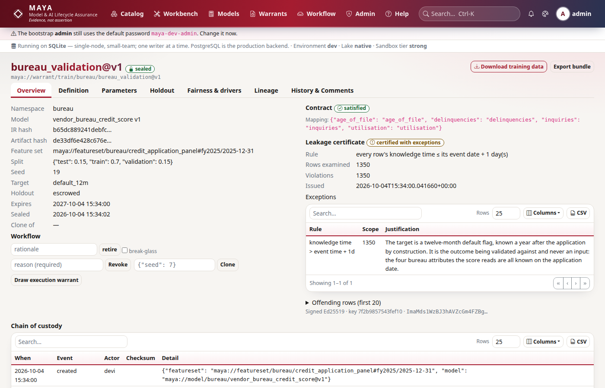

# Tutorial 7 · The training warrant and blind scoring

A model is fitted under a **training warrant**: a record of one attempt to fit
one approved model version to one pinned data set. Before any data leaves, the
warrant checks that the data meets the model's input contract, certifies that
no row uses something nobody knew at the time, and escrows a test partition
that the modeller never sees. The data goes out with a checksum. Parameters come
back quoting it, and are checked against the model's bounds and constraints.
Then MAYA scores them blind on the escrowed rows and counts every attempt.

In this tutorial **devi** fits the scorecard from tutorials 5 and 6 on two
years of credit history, and **mgr** approves the result.

## Time to complete

35 minutes.

## Before you start

- [Tutorial 4](/help/guides/tutorial-04-feature-sets-and-pins): the features
  `credit/accounts` and `credit/bureau`, the set `credit/panel`, and **devi**
  (model developer).
- [Tutorial 6](/help/guides/tutorial-06-inputs-and-specification): the approved
  model `credit/pd@v1`, with bounds on its parameters and the PD floor
  constraint, and **mgr** (model manager).
- A terminal in a working directory. The tutorial writes three CSV files and
  `train.parquet` there.

## What you will learn

- Why a model needs a target, and why a target is always "late".
- What a leakage certificate checks, why it refuses, and how to justify an
  exception in writing.
- How the input contract is checked when the warrant is drawn.
- How the data is issued with a checksum, and what an escrowed holdout is.
- How parameters are checked at upload: bounds, the joint constraint, and the
  checksum.
- How blind scoring works, and why every attempt is counted.
- How parameters and the warrant are approved, and what sealing means.

## Step 1 · Reconnect, and write two years of history

The panel in tutorial 4 had three accounts and no outcome, enough to show a
feature set, not to fit a model. A scorecard is fitted on history: for each
account and month, the drivers, and whether the account defaulted in the twelve
months that followed. This step writes that history for 200 accounts over the
first half of 2024, from a known scorecard plus noise, so you can see later how
close the fit comes.

```python
# reconnect, then simulate six months of 2024 for 200 accounts
import datetime as dt
import os

import numpy as np

import maya.sdk as maya

URL = os.environ.get("MAYA_URL", "http://127.0.0.1:8600")
PW = "Tutorial-pass-1"


def key_for(user, password=PW):
    """Sign in and create an API key for that person."""
    token = maya.Client(URL).auth.login(user, password)["token"]
    return maya.Client(URL, token=token).auth.create_api_key("tutorial")["api_key"]


def connect_as(user, password=PW):
    """Sign in, create an API key, and return a client acting as that person."""
    return maya.connect(base_url=URL, api_key=key_for(user, password))


dana, mick, devi, mgr = (connect_as(u) for u in ("dana", "mick", "devi", "mgr"))

MONTHS = ["2024-01-31", "2024-02-29", "2024-03-31", "2024-04-30", "2024-05-31", "2024-06-30"]
TRUE = {"beta0": -3.0, "beta1": 2.0, "beta2": 1.5, "beta3": -0.8}  # the scorecard behind the data


def later(month_end, days):
    return f"{dt.date.fromisoformat(month_end) + dt.timedelta(days=days)}T08:00:00Z"


rng = np.random.default_rng(2024)
accounts = ["date,account,utilisation,dti,kt"]
bureau = ["date,account,bureau_score,kt"]
defaults = ["date,account,default_12m,kt"]
for n in range(200):
    account = f"A{n:04d}"
    util0, dti0, score0 = rng.uniform(0.05, 0.95), rng.uniform(0.1, 0.6), rng.normal(680, 60)
    for month in MONTHS:
        util = float(np.clip(util0 + rng.normal(0, 0.03), 0, 1.2))
        dti = float(np.clip(dti0 + rng.normal(0, 0.02), 0, 1))
        score = float(np.clip(score0 + rng.normal(0, 8), 300, 850))
        z = (
            TRUE["beta0"]
            + TRUE["beta1"] * util
            + TRUE["beta2"] * dti
            + TRUE["beta3"] * (score - 680) / 60
        )
        defaulted = int(rng.random() < 1 / (1 + np.exp(-z)))
        accounts.append(f"{month},{account},{util:.3f},{dti:.3f},{later(month, 5)}")
        bureau.append(f"{month},{account},{score:.0f},{later(month, 10)}")
        defaults.append(f"{month},{account},{defaulted},{later(month, 365)}")  # known a year later

for name, lines in [
    ("history-accounts.csv", accounts),
    ("history-bureau.csv", bureau),
    ("defaults.csv", defaults),
]:
    with open(name, "w") as fh:
        fh.write("\n".join(lines) + "\n")
print(
    len(accounts) - 1,
    "account-months,",
    sum(int(line.split(",")[2]) for line in defaults[1:]),
    "defaults",
)
```

You should see 1,200 account-months, of which 287 defaulted within a year:

```text
1200 account-months, 287 defaults
```

Look at the knowledge times. Servicing data is known five days after month end,
the bureau score ten. Whether an account defaulted within twelve months is
known, at the earliest, twelve months later. A target is late by construction.

## Step 2 · A target, and a training panel

dana loads the history into the two existing features (new accounts and months,
so not restatements) and creates a third feature for the outcome. Then devi
builds a training panel: the same mapping as `credit/panel`, plus the target.

```python
# load the history, and create the outcome feature
for ref, path in [
    ("credit/accounts", "history-accounts.csv"),
    ("credit/bureau", "history-bureau.csv"),
]:
    with open(path, "rb") as fh:
        out = dana.features.ingest(ref, fh.read(), fmt="csv", filename=path)
    print(ref, out["rows"], "rows, restatement:", out["restatement"])

outcome = {
    "index": ["date", "account"],
    "index_types": {"date": "date", "account": "string"},
    "schema": [{"name": "default_12m", "type": "int64", "unit": "flag"}],
    "source": {"type": "csv", "knowledge_time_column": "kt"},
    "resolution": {"grid": "as_is", "rules": {}},
    "transform": [],
    "quality": [
        {"check": "not_null", "attr": "default_12m"},
        {"check": "range", "attr": "default_12m", "min": 0, "max": 1},
    ],
}
dana.features.create(
    "credit", "defaults", outcome, description="Default within the following 12 months"
)
with open("defaults.csv", "rb") as fh:
    dana.features.ingest("credit/defaults", fh.read(), fmt="csv")
dana.features.transition("credit/defaults", 1, "submit")
print("credit/defaults", mick.features.transition("credit/defaults", 1, "approve")["state"])
```

You should see both features take 1,200 new rows each, and the outcome feature
approved:

```text
credit/accounts 1200 rows, restatement: False
credit/bureau 1200 rows, restatement: False
credit/defaults approved
```

```python
# devi builds the training panel: credit/panel's mapping plus the target; mick pins it
panel = devi.featuresets.get("credit/panel")["versions"][-1]["definition"]
training = dict(
    panel,
    members=panel["members"]
    + [
        {
            "attr": "default_12m",
            "ref": "maya://feature/credit/defaults@v1",
            "source_attr": "default_12m",
        },
    ],
)
devi.featuresets.create(
    "credit",
    "training_panel",
    training,
    description="The scorecard panel with its 12-month default flag",
)
devi.featuresets.transition("credit/training_panel", 1, "submit")
print(mick.featuresets.transition("credit/training_panel", 1, "approve")["state"])
out = mick.featuresets.pin(
    "credit/training_panel", version_no=1, pin_name="fit", as_of="2024-06-30", cascade=True
)
result = mick.wait(out["job"])["result"]
print(result["rows"], "rows,", result["cascaded_member_pins"], "member pins")
```

You should see the set approved, and pinned with its three members as of
30 June 2024:

```text
approved
1200 rows, 3 member pins
```

The pin's date keeps the 2026 rows from tutorial 4 out: only the 2024 history
is in it. Why a new set rather than a version 2 of `credit/panel`? A new
version that adds a column could not be pinned beside version 1's pins (see
*If something goes wrong*), and a training panel with a target is a different
thing from the scoring panel anyway: nothing scores on `default_12m`.

## Step 3 · Draw the warrant, and meet the leakage certificate

devi draws a warrant binding `credit/pd@v1` to the pin, naming the target:

```python
# a warrant that says nothing about the target's lateness
PIN = "maya://featureset/credit/training_panel#fit/2024-06-30"
naive = devi.training.create(
    "credit", "pd_fit_naive", "credit/pd@v1", PIN, spec={"target": "default_12m"}
)
cert = naive["leakage_certificate"]
print(cert["rule"])
print(cert["rows_examined"], "rows,", cert["violations"], "violations, status:", cert["status"])
print(cert["examples"][0])
try:
    devi.training.transition(naive["id"], "submit")
except maya.NotApproved as exc:
    print(type(exc).__name__, exc)
```

You should see every row violate the rule, the certificate refused, and the
warrant unable to be submitted:

```text
every row's knowledge time ≤ its event date + 1 day(s)
1200 rows, 1200 violations, status: refused
{'date': '2024-01-31', 'account': 'A0000', '_knowledge_time': '2025-01-30 08:00:00+00:00'}
NotApproved Blocked by check(s): leakage_certified — leakage certificate: refused; 1200 violating row(s)
```

The **leakage certificate** compares each row's knowledge time with its event
date. A row's knowledge time is the latest of the values it combines, and every
row includes the target, known a year later. That is exactly what a leak looks
like: a value the model could not have had on the day. MAYA cannot tell a
legitimate target from a leaked driver by looking, so it refuses, and leaves it
to a person to say which this is.

## Step 4 · Draw it again, with the exception written down

The wrong answer is to widen the rule (`leakage_lag_days`). The right one is to
write down why this exception is sound, where a reviewer will read it:

```python
# the same warrant, with the reason for the late rows stated
tw = devi.training.create(
    "credit",
    "pd_fit_2024",
    "credit/pd@v1",
    PIN,
    spec={
        "target": "default_12m",
        "seed": 11,
        "metrics": ["rmse", "mae"],
        "leakage_justification": (
            "The target default_12m is known twelve months after its observation month by "
            "construction, and is never a model input. Every driver is known within ten days."
        ),
    },
)
cert = tw["leakage_certificate"]
print(tw["state"], "|", cert["status"], "|", cert["exceptions"][0]["rows"], "rows excepted")
print("contract:", tw["contract_report"]["ok"], tw["contract_report"]["mapping"])
print("split:", tw["spec"]["split"], "seed:", tw["spec"]["seed"])
print("holdout:", tw["spec"]["holdout"], tw["holdout_rows"], "rows")
```

You should see the certificate issued with the exception recorded, the input
contract satisfied, the split, and 186 rows escrowed:

```text
draft | certified_with_exceptions | 1200 rows excepted
contract: True {'bureau': 'bureau', 'dti': 'dti', 'utilisation': 'utilisation'}
split: {'train': 0.7, 'validation': 0.15, 'test': 0.15} seed: 11
holdout: escrowed 186 rows
```

Three things happened when the warrant was drawn:

- **The contract was checked.** Each feature input of the model, `bureau`,
  `dti` and `utilisation`, found a numeric column of the same name, and the
  target exists. A mismatch would refuse the warrant, listing every problem.
  When names differ, `bindings` maps input to column.
- **The certificate was issued and signed**, with the exception and its
  justification inside it. It will travel with the parameters and the bundle.
  It is still one justification for whole rows: had a driver also been late,
  it would sit under the same exception, which is why the reviewer reads it.
- **The split was fixed.** Each row's partition comes from hashing the seed with
  its key, so the same seed gives the same split, every time. The `test` rows
  are **escrowed**: they never leave MAYA.

On screen: **Warrants → New training warrant** (`/warrants/training/new`).



## Step 5 · Download the data, by checksum

```python
# download the training data; the SDK checks the checksum MAYA issued
table, manifest = devi.training_data(tw["id"])
df = table.to_pandas()
print(manifest["rows"], "rows, holdout escrowed:", manifest["escrowed_holdout"])
print(df["_split"].value_counts().to_dict())
print(manifest["checksum"])
```

You should see 1,014 rows, the training and validation partitions only, and the
checksum:

```text
1014 rows, holdout escrowed: True
{'train': 821, 'validation': 193}
c3d5ab0ec7031b2f93516c80bb1604fa649016fac51a5cc0b25679d157e21389
```

The 186 test rows stayed behind. The download was recorded in the warrant's
custody chain, with that checksum, which is how MAYA will later know the
parameters were fitted on data it issued. The command line does the same, as
devi:

```python
# the command line acts as whoever's key is in MAYA_API_KEY: here, devi
os.environ["MAYA_API_KEY"] = key_for("devi")
os.environ["WARRANT_ID"] = tw["id"]
```

```bash
# fetch the warrant's data to a file, verifying the checksum
python -m maya.cli warrant fetch "$WARRANT_ID" --out train.parquet
```

You should see the same rows and checksum:

```text
train.parquet: 1014 rows; checksum verified c3d5ab0ec7031b2f93516c80bb1604fa649016fac51a5cc0b25679d157e21389
```

## Step 6 · Fit, anywhere

Fitting happens on your own machine, with your own tools. MAYA does not care
how, only what data you used and what came out. Here, logistic regression by
Newton's method on the training partition, scaling the bureau score exactly as
the model declares:

```python
# fit the scorecard on the train partition; check it on validation
def design(frame):
    return np.column_stack(
        [np.ones(len(frame)), frame["utilisation"], frame["dti"], (frame["bureau"] - 680.0) / 60.0]
    )


train = df[df["_split"] == "train"]
X, y = design(train), train["default_12m"].to_numpy(dtype=float)
beta = np.zeros(4)
for _ in range(25):
    p = 1 / (1 + np.exp(-X @ beta))
    beta = beta + np.linalg.solve(X.T @ (X * (p * (1 - p))[:, None]), X.T @ (y - p))
fitted = {f"beta{i}": round(float(b), 4) for i, b in enumerate(beta)}
print(fitted)

validation = df[df["_split"] == "validation"]
pv = 1 / (1 + np.exp(-design(validation) @ beta))
print("validation RMSE:", round(float(np.sqrt(np.mean((pv - validation["default_12m"]) ** 2))), 4))
```

You should see coefficients near the true scorecard (−3, 2, 1.5, −0.8), as near
as 821 noisy rows allow, and the validation error:

```text
{'beta0': -3.0367, 'beta1': 2.5035, 'beta2': 0.9288, 'beta3': -0.9123}
validation RMSE: 0.4039
```

On a 0/1 target the RMSE is the square root of the Brier score: a calibration
measure, not a ranking one.

## Step 7 · Bounds and the floor, at upload

Tutorial 6 declared bounds on each parameter and a PD floor across `beta0` and
`beta3`. They are enforced here, when parameters arrive. Two uploads that should
never reach a reviewer:

```python
# each value inside its bounds, but the pair breaks the PD floor
try:
    devi.training.upload_parameters(
        tw["id"],
        {"beta0": -6.0, "beta1": 2.0, "beta2": 1.5, "beta3": -0.9},
        data_checksum=manifest["checksum"],
    )
except maya.ValidationFailed as exc:
    print(type(exc).__name__, exc)

# a negative weight on utilisation: more debt, lower risk
try:
    devi.training.upload_parameters(
        tw["id"],
        {"beta0": -3.0, "beta1": -1.0, "beta2": 1.5, "beta3": -0.8},
        data_checksum=manifest["checksum"],
    )
except maya.ValidationFailed as exc:
    print(type(exc).__name__, exc)
```

You should see both refused, the first quoting the constraint's reason:

```text
ValidationFailed Parameters out of bounds: constraint ≥ -7.6 is violated: beta0=-6 + beta3=-0.9 gives -8.54997 — PD floor of 0.05%: even the best applicant (utilisation 0, DTI 0, score 850) may not be given a lower PD
ValidationFailed Parameters out of bounds: 'beta1'=-1.0 outside [0, 10]
```

## Step 8 · A checksum MAYA never issued

Suppose devi fits on an extract she kept from last quarter, and quotes its
checksum. The upload is accepted, but flagged:

```python
# parameters quoting a checksum MAYA never issued
stale = devi.training.upload_parameters(
    tw["id"], fitted, data_checksum="0" * 64, notes="fitted on an old extract"
)
print(stale["state"], "verified:", stale["verified_data"], "flag:", stale["flag"])
devi.training.parameter_transition(stale["id"], "submit")
try:
    mgr.training.parameter_transition(stale["id"], "approve")
except maya.NotApproved as exc:
    print(type(exc).__name__, exc)
print(devi.training.parameter_transition(stale["id"], "withdraw")["state"])

# the honest upload, quoting the checksum of the data issued in step 5
ps = devi.training.upload_parameters(
    tw["id"], fitted, metrics={"rmse_validation": 0.4039}, data_checksum=manifest["checksum"]
)
print(ps["state"], "verified:", ps["verified_data"], "flag:", ps["flag"])
```

You should see the stale set flagged, its approval blocked, devi withdrawing
it, and the honest set verified:

```text
draft verified: False flag: unverified_data
NotApproved Blocked by check(s): data_verified_or_justified — unverified_data: the checksum does not match any download MAYA issued; approve only with an explicit justification
withdrawn
draft verified: True flag: None
```

The checksum cycle ties a set of parameters to the data MAYA issued under this
warrant. A set fitted on anything else can still be approved, but only with a
written justification on the approval, for the record.

## Step 9 · Blind scoring, and the attempt counter

Now the escrowed rows. MAYA evaluates the model on them and returns metrics,
never rows. devi scores her set, and then, curious, the true scorecard too:

```python
# score on the escrowed holdout: metrics out, rows never
first = devi.training.score_holdout(tw["id"], parameter_set_id=ps["id"])
print("attempt", first["attempt"], {k: round(v, 4) for k, v in first["metrics"].items()})
second = devi.training.score_holdout(tw["id"], values=TRUE)
print("attempt", second["attempt"], {k: round(v, 4) for k, v in second["metrics"].items()})
print(first["note"])
print("attempts on the warrant:", devi.training.get(tw["id"])["holdout_attempts"])
```

You should see two scored attempts on the 186 rows, numbered, and the count
kept on the warrant:

```text
attempt 1 {'rmse': 0.3959, 'mae': 0.3127, 'rows': 186}
attempt 2 {'rmse': 0.3945, 'mae': 0.3125, 'rows': 186}
Every attempt is counted and shown on the warrant.
attempts on the warrant: 2
```

A holdout is only honest if it is looked at rarely. Score twenty sets and keep
the best, and the holdout has quietly become training data. MAYA cannot stop
you peeking, so it makes peeking visible: the count is on the warrant, in its
bundle, and in front of the reviewer.

## Step 10 · Approve the parameters, then approve and seal the warrant

```python
# devi submits the parameters; mgr approves them
devi.training.parameter_transition(ps["id"], "submit")
r = mgr.training.parameter_transition(ps["id"], "approve", rationale="Fitted on issued data")
print(r["state"])
for c in r["checks"]:
    print(" ", c["check"], c["passed"], "-", c["detail"])

# then the warrant itself, and the seal
r = devi.training.transition(tw["id"], "submit")
print(r["state"], [c["check"] for c in r["checks"]])
print(mgr.training.transition(tw["id"], "approve")["state"])
print("sealed:", mgr.training.seal(tw["id"])["sealed_at"] is not None)
try:
    devi.training.upload_parameters(tw["id"], fitted, data_checksum=manifest["checksum"])
except maya.NotApproved as exc:
    print(type(exc).__name__, exc)
```

You should see the parameters approved with their three checks, the warrant
reviewed and sealed, and no further uploads accepted:

```text
approved
  parameters_within_bounds True - all parameters within declared bounds
  data_verified_or_justified True - trained on data MAYA issued (checksum matched)
  no_open_blocking_comments True - no open blocking comments
in_review ['contract_valid', 'leakage_certified']
approved
sealed: True
NotApproved The warrant is sealed; clone it to train again
```

Sealing freezes the warrant: its data, certificate, attempts and approved
parameters are now one record. To fit again, clone it; the clone starts with
its own counter at zero, and both are visible. A trainable model's warrant
seals only once a parameter set is approved.

## Next steps

- [Tutorial 8 · Execution warrants, covenants and monitoring](/help/guides/tutorial-08-execution-and-monitoring)
  puts these parameters to work, under limits and covenants.
- [Warrants](/help/warrants#training-warrants) lists every spec key of a
  training warrant.

## If something goes wrong

| What you see | Why | What to do |
|---|---|---|
| `leakage_certified` blocks submission | Rows were known later than their event date allows | If it is the target, give `leakage_justification`; if it is a driver, fix the data |
| The warrant is refused on its contract | A model input has no numeric column of that name, or the target is missing | Map names with `bindings`, or add the column to the set |
| A pin of a new set version fails with `Append schema does not match` | A set version that changes the columns cannot be pinned beside an earlier version's pins | Build a new set, as step 2 does |
| `Parameters out of bounds` | A value is outside its bounds, or a constraint fails | Read the message: it names the parameter, or quotes the constraint's reason |
| `data_verified_or_justified` blocks approval | The quoted checksum was never issued under this warrant | Refit on the issued data, or approve with a written justification |
| `The warrant is sealed` | Sealing is final | Clone the warrant to fit again |
