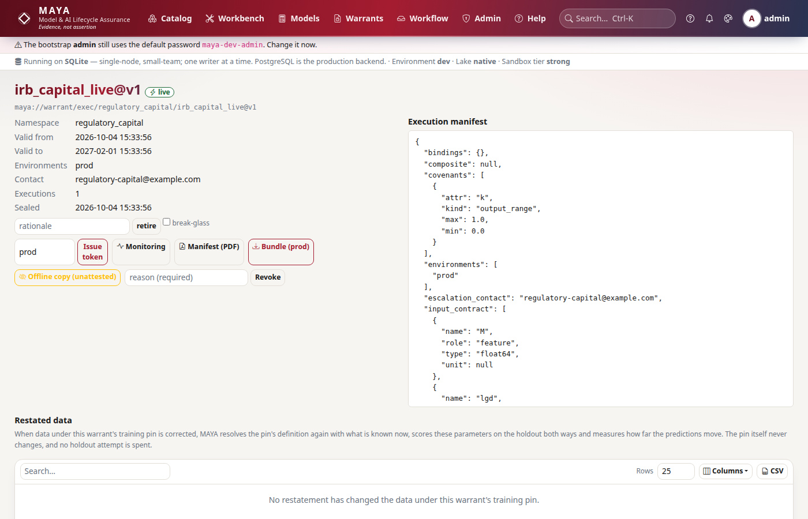
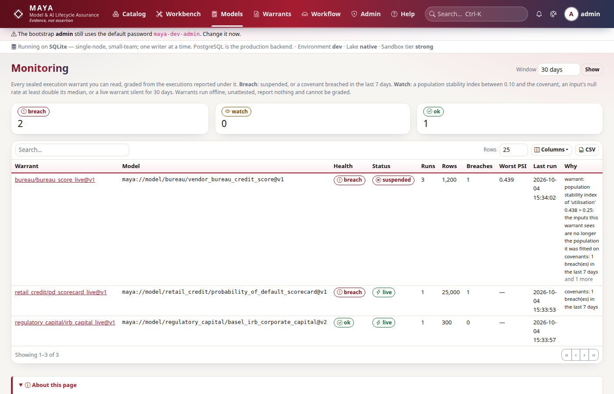

# Tutorial 8 · Execution warrants, covenants and monitoring

A sealed training warrant says the scorecard was fitted properly. It does not
say anyone may use it. That is an **execution warrant**: a permission to run one
model version with one approved parameter set, in named environments, for a
limited time, under **limits** that throttle and **covenants** that suspend. A
covenant is a promise about the data the model will see and the answers it
will give. Break one and the warrant suspends itself, and every call that needs
it fails closed until a person with the authority says why it may resume.

In this tutorial the scorecard goes live. You score three monthly batches, watch
the population drift, see a breach suspend the warrant, reinstate it, and
assess a correction to the data the model was fitted on.

## Time to complete

30 minutes.

## Before you start

- [Tutorial 7 · The training warrant and blind scoring](/help/guides/tutorial-07-training-warrant):
  the sealed training warrant `credit/pd_fit_2024` and its approved parameter
  set, and the people **devi** and **mgr**.
- [Tutorial 5](/help/guides/tutorial-05-write-a-model) for the reference code,
  which this tutorial uses as its runtime.
- The admin password, to add two people.

## What you will learn

- What an execution warrant binds, and what its environments, validity, limits
  and covenants mean.
- Why an execution warrant needs two people, and a model owner in production.
- How a runtime fetches what it needs, scores, and reports back.
- How a population stability covenant compares live inputs with the fitted
  population.
- How monitoring grades a live model `ok`, `watch` or `breach`.
- How a breach suspends a warrant, how calls fail closed, and who may reinstate.
- What MAYA does when data under the training pin is corrected.

## Step 1 · Reconnect, and add a second manager and an owner

Two more people. **lara** is a second *model manager*: an execution warrant is
approved by someone other than the manager who drew it. **owen** is the *model
owner*: accountable for the scorecard in use, and the person who may lift a
suspension.

```python
# reconnect; the admin adds lara and owen; find the sealed warrant from tutorial 7
import datetime as dt
import os

import numpy as np

import maya.sdk as maya

URL = os.environ.get("MAYA_URL", "http://127.0.0.1:8600")
PW = "Tutorial-pass-1"


def key_for(user, password=PW):
    """Sign in and create an API key for that person."""
    token = maya.Client(URL).auth.login(user, password)["token"]
    return maya.Client(URL, token=token).auth.create_api_key("tutorial")["api_key"]


def connect_as(user, password=PW):
    """Sign in, create an API key, and return a client acting as that person."""
    return maya.connect(base_url=URL, api_key=key_for(user, password))


admin = connect_as("admin", "maya-dev-admin")  # your admin password, if you changed it
admin.admin.create_user("lara", password=PW, roles=["model_manager"])
admin.admin.create_user("owen", password=PW, roles=["model_owner"])
dana, devi, mgr, lara, owen = (connect_as(u) for u in ("dana", "devi", "mgr", "lara", "owen"))

tw = next(w for w in mgr.training.list() if w["name"] == "pd_fit_2024")
tw = mgr.training.get(tw["id"])
ps = next(p for p in tw["parameter_sets"] if p["state"] == "approved")
print(tw["name"], "sealed:", tw["sealed_at"] is not None)
print(ps["values"])
```

You should see the sealed warrant and the parameters devi fitted:

```text
pd_fit_2024 sealed: True
{'beta0': -3.0367, 'beta1': 2.5035, 'beta2': 0.9288, 'beta3': -0.9123}
```

## Step 2 · Draw the execution warrant

mgr draws the warrant. Each part of its spec is a decision someone will be
asked to defend:

- **environments**: `dev` and `uat`. Not `prod`: that needs the owner's
  approval as well, and is for when the scorecard has earned it.
- **valid_days**: 180. When it lapses, the model stops; renewing is a decision.
- **contact**: named in every refusal, so whoever is stopped knows whom to call.
- **limits** throttle: at most 500 calls a day, 10,000 rows a call.
- **covenants** suspend:
  - `input_null_rate` on `bureau`: at most 5% missing scores.
  - `input_range` on `utilisation`: between 0 and 1.5, as fitted.
  - `input_psi` on `bureau`: the population stability index of the live scores
    against the scores the model was fitted on, at most 0.25.
  - `output_range`: every PD between the 0.05% floor and 99%.

```python
# mgr draws the warrant: two environments, 180 days, limits and four covenants
ew = mgr.execution.create(
    "credit",
    "pd_live",
    training_warrant_id=tw["id"],
    parameter_set_id=ps["id"],
    spec={
        "environments": ["dev", "uat"],
        "valid_days": 180,
        "contact": "credit-risk@example.com",
        "limits": {"max_calls_per_day": 500, "max_rows_per_call": 10000},
        "covenants": [
            {"kind": "input_null_rate", "attr": "bureau", "max": 0.05},
            {"kind": "input_range", "attr": "utilisation", "min": 0, "max": 1.5},
            {"kind": "input_psi", "attr": "bureau", "max": 0.25},
            {"kind": "output_range", "min": 0.0005, "max": 0.99},
        ],
    },
)
print(ew["state"])
for c in ew["spec"]["covenants"]:
    print(" ", c["kind"], c["attr"], "| baseline captured:", "baseline" in c)
psi_covenant = next(c for c in ew["spec"]["covenants"] if c["kind"] == "input_psi")
print("bureau bins:", psi_covenant["bin_edges"])
print("fitted counts:", psi_covenant["baseline"])
```

You should see a draft with its four covenants, the output covenant filled in
as `pd` (the model's only output), and a baseline captured for the PSI
covenant: ten bins of the fitted bureau scores, about 120 in each:

```text
draft
  input_null_rate bureau | baseline captured: False
  input_range utilisation | baseline captured: False
  input_psi bureau | baseline captured: True
  output_range pd | baseline captured: False
bureau bins: [520.0, 593.0, 621.0, 646.0, 663.0, 676.0, 689.0, 703.0, 721.2, 759.0, 850.0]
fitted counts: [119, 117, 121, 116, 125, 114, 120, 128, 119, 121]
```

The baseline is taken from the data the training warrant issued, at creation,
and cannot move later. Drift only means something against the population the
model was actually fitted on. A covenant naming no output would watch nothing,
so MAYA fills it in when there is one output, and refuses to guess when there
are several.

## Step 3 · Two people approve, then the seal

```python
# mgr submits and cannot approve his own warrant; lara approves; mgr seals;
# the admin makes owen the warrant's accountable owner
r = mgr.execution.transition(ew["id"], "submit")
print(r["state"], [c["check"] for c in r["checks"]])
try:
    mgr.execution.transition(ew["id"], "approve")
except maya.PermissionDenied as exc:
    print(type(exc).__name__, exc)
print(
    lara.execution.transition(ew["id"], "approve", rationale="Covenants agreed with risk")["state"]
)

sealed = mgr.execution.seal(ew["id"])
g = admin.access.grant("execution_warrant", ew["id"], "user", "owen", "own", days=None)
print("owen:", g["level"])
valid = dt.datetime.fromisoformat(sealed["valid_to"]) - dt.datetime.fromisoformat(
    sealed["valid_from"]
)
print("sealed, valid for", valid.days, "days")
```

You should see mgr stopped by separation of duties, lara's approval, owen's
grant, and the seal with its 180 days:

```text
in_review ['parameters_approved']
PermissionDenied segregation of duties (two_person): you created, submitted or last modified this object, so you cannot approve it
approved
owen: own
sealed, valid for 180 days
```

`parameters_approved` checks the parameter set the warrant names was approved
under its training warrant. The `own` grant is what makes owen *this*
warrant's owner: the model-owner role says what an owner may do, the grant says
which warrants he answers for. A warrant that lists `prod` would also need owen's
approval, as model owner.



## Step 4 · Run under the warrant, and report back

A runtime asks MAYA for the warrant's **bundle** for its environment: the
formula IR, the approved parameters, the manifest, and a signed token valid for
15 minutes. It scores, then reports what it saw. Covenants are evaluated on
every report.

Here the runtime is the reference code from tutorial 5, fed the bundle's
parameters (the constants `mu` and `sigma` come from their declared values).
For the PSI covenant it bins the bureau scores on the covenant's own edges:

```python
# a small runtime: fetch the bundle, score a batch, report the statistics
reference = {}
exec(devi.models.reference_code("credit/pd", 1)["source"], reference)
edges = np.array(psi_covenant["bin_edges"])


def monthly_batch(seed, shift=0.0, n=500):
    """500 accounts; `shift` moves the bureau scores down, as a drifting population would."""
    r = np.random.default_rng(seed)
    return {
        "utilisation": r.uniform(0.05, 0.95, n),
        "dti": r.uniform(0.1, 0.6, n),
        "bureau": r.normal(680 - shift, 60, n),
    }


def score_and_report(X, environment="dev"):
    bundle = devi.execution.bundle(ew["id"], environment)
    pd_ = reference["predict"](X, bundle["parameters"])["pd"]
    counts, _ = np.histogram(np.clip(X["bureau"], edges[0], edges[-1]), bins=edges)
    return devi.execution.report(
        ew["id"],
        environment,
        rows=len(pd_),
        input_stats={
            "bureau": {"null_rate": 0.0, "histogram": counts.tolist()},
            "utilisation": {
                "min": float(X["utilisation"].min()),
                "max": float(X["utilisation"].max()),
            },
        },
        output_stats={"pd": {"min": float(pd_.min()), "max": float(pd_.max())}},
    )


bundle = devi.execution.bundle(ew["id"], "dev")
print(bundle["warrant"], bundle["status"])
try:
    devi.execution.bundle(ew["id"], "prod")
except maya.PermissionDenied as exc:
    print(type(exc).__name__, exc)

print("July:", score_and_report(monthly_batch(7)))
print("health:", mgr.monitoring.overview()["warrants"][0]["health"])
```

You should see the warrant live, `prod` refused, July's report accepted with
no breaches, and the health `ok`:

```text
maya://warrant/exec/credit/pd_live@v1 live
PermissionDenied Warrant is not valid in 'prod'
July: {'accepted': True, 'breaches': [], 'limits_exceeded': [], 'status': 'live'}
health: ok
```

A run that is not reported is not attested. MAYA can only hold a model to its
covenants on what it is told, which is why the report is part of the contract,
and why a live warrant that reports nothing for 30 days is itself graded
`watch`.

## Step 5 · A drifting population

In August the scores arriving are, on average, 20 points lower: new marketing
brought in thinner credit files. Nothing is broken yet.

```python
# August: the bureau scores drift down by 20 points
print("August:", score_and_report(monthly_batch(8, shift=20))["status"])
for signal in mgr.monitoring.warrant(ew["id"])["signals"]:
    print(signal["level"], "|", signal["what"], "|", signal["why"])
print("health:", mgr.monitoring.overview()["warrants"][0]["health"])
```

You should see the warrant still live, one signal at `watch` naming the PSI,
and the health `watch`:

```text
August: live
watch | bureau | PSI 0.147 against the fitted population (watch above 0.1, covenant 0.25)
health: watch
```

The convention: a PSI under 0.10 is stable, 0.10 to 0.25 worth watching, above
0.25 a different population. Monitoring reads all of a warrant's reports as
series, so a slow drift is visible before any covenant fires. On screen this is
**Monitoring** (`/monitoring`).



## Step 6 · A breach suspends, and every call fails closed

In September the bureau changes its own scorecard, and every score falls by
about 80 points. The runtime does not know; it scores and reports as usual:

```python
# September: the bureau rescales its scores
r = score_and_report(monthly_batch(9, shift=80))
print(r["status"], "|", r["breaches"][0]["detail"])

# every call that needs the warrant now fails, in every environment
try:
    devi.execution.bundle(ew["id"], "dev")
except maya.WarrantSuspended as exc:
    print(type(exc).__name__, exc)
try:
    devi.execution.token(ew["id"], "uat")
except maya.WarrantSuspended as exc:
    print(type(exc).__name__)
print("health:", mgr.monitoring.overview()["warrants"][0]["health"])
```

You should see the report accepted but the warrant suspended, the bundle and the
token refused with the reason and the contact, and the health `breach`:

```text
suspended | population stability index of 'bureau' 2.167 > 0.25: the inputs this warrant sees are no longer the population it was fitted on
WarrantSuspended Warrant suspended: population stability index of 'bureau' 2.167 > 0.25: the inputs this warrant sees are no longer the population it was fitted on. Contact credit-risk@example.com.
WarrantSuspended
health: breach
```

September's scores were computed, because the runtime ran before it reported.
The next call cannot be: the warrant fails closed. That is the trade a covenant
makes. It is better to stop scoring than to keep giving PDs to a population the
model has never seen.

## Step 7 · Reinstatement, with a reason

Only the model owner or an administrator may lift a suspension, and only with a
written reason. A model manager may not: the person who approved the warrant is
not the person who decides it is safe to resume.

```python
# mgr may not reinstate; owen, the owner, does, saying why
try:
    mgr.execution.reinstate(ew["id"], "looks fine")
except maya.PermissionDenied as exc:
    print(type(exc).__name__, exc)
owen.execution.reinstate(
    ew["id"],
    "The bureau restored its old score scale on 3 October; September's batch to be rescored",
)
print(devi.execution.bundle(ew["id"], "dev")["status"])
print("health:", mgr.monitoring.overview()["warrants"][0]["health"])
```

You should see mgr refused, the warrant live again, and the health still
`breach`:

```text
PermissionDenied Only the model owner or an administrator reinstates
live
health: breach
```

The health stays at `breach` for seven days after the last breach. A
reinstatement is a decision, not an erasure: the breach, the suspension and
owen's reason are all in the warrant's custody chain.

## Step 8 · Restated data under the training pin

A correction arrives: account A0007's servicing record for March 2024 was
wrong. That month is inside the training pin. The pin does not move, as
tutorial 3 showed, but the live model was fitted on the story the pin tells.
MAYA notices: after every restatement, it re-resolves each live warrant's
training pin with what is known now, and measures the difference, without
showing anyone a row.

```python
# the correction, then the assessment of the live warrant
now = dt.datetime.now(dt.timezone.utc).strftime("%Y-%m-%dT%H:%M:%SZ")
correction = f"date,account,utilisation,dti,kt\n2024-03-31,A0007,0.950,0.550,{now}\n"
out = dana.features.ingest(
    "credit/accounts", correction.encode(), fmt="csv", note="servicing correction"
)
print("restatement:", out["restatement"])

mgr.wait(mgr.execution.check_restatements(ew["id"]))
impact = mgr.execution.restatements(ew["id"])[0]
print(impact["state"], impact["rows"])
print(
    "holdout RMSE, sealed vs corrected:",
    round(impact["metrics_sealed"]["rmse"], 4),
    round(impact["metrics_corrected"]["rmse"], 4),
)
print(
    "predictions moved:",
    f"{impact['shift']['share_moved']:.2%}",
    "of rows; largest move",
    round(impact["shift"]["max_abs"], 4),
)

mgr.execution.acknowledge_restatement(
    impact["id"], "One account in the holdout; the fit is unaffected. No refit."
)
print(mgr.execution.restatements(ew["id"])[0]["state"])
```

You should see the restatement recognised, one row changed (it is in the
holdout), the blind score both ways, how far the predictions moved, and the
impact acknowledged:

```text
restatement: True
open {'compared': 1200, 'changed': 1, 'changed_in_holdout': 1, 'added': 0, 'dropped': 0}
holdout RMSE, sealed vs corrected: 0.3959 0.3949
predictions moved: 0.08% of rows; largest move 0.2703
acknowledged
```

Nothing was suspended. Whether a correction invalidates a model is a judgement,
and this is the evidence for it: the owner and every model manager were
notified, and the acknowledgement records what was decided, and by whom. A
correction that moved many predictions would argue for a refit: clone the
training warrant and fit again.

## Next steps

- [Tutorial 9 · Evidence bundles, verified offline](/help/guides/tutorial-09-evidence-bundles)
  exports the whole chain as a signed file anyone can check without MAYA.
- [Warrants](/help/warrants#execution-warrants) lists every limit and covenant.

## If something goes wrong

| What you see | Why | What to do |
|---|---|---|
| `segregation of duties (two_person)` on approval | The person who drew or submitted the warrant cannot approve it | A second model manager approves |
| `Warrant is not valid in 'prod'` | The warrant lists only `dev` and `uat` | Draw a warrant listing `prod`; the model owner must approve it too |
| `WarrantSuspended` | A covenant was breached | Read the reason; fix the cause; the model owner reinstates with a reason |
| `an input_psi covenant needs a baseline` | The warrant was not drawn from a training warrant | Draw it from one, or declare `baseline` and `bin_edges` |
| `Only the model owner or an administrator reinstates` | A manager tried, or the owner has no `own` grant on this warrant | The admin grants `own`, as in step 3; then owen reinstates |
| A PSI that never fires | The runtime did not report a `histogram` on the covenant's `bin_edges` | Bin the live values on the edges in the covenant, as step 4 does |
