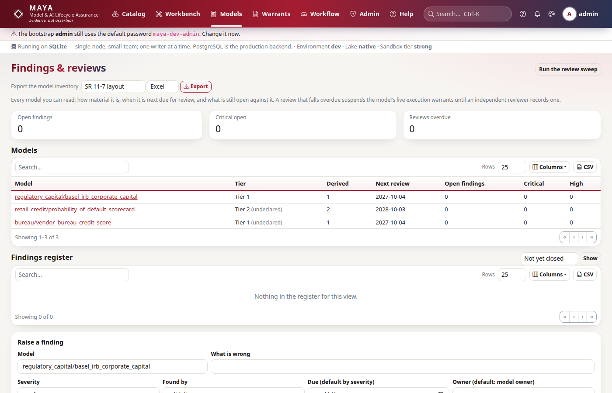

# Tutorial 11 · Findings, tiers and periodic review

Approval is one moment. A model risk function keeps watching after it: it
decides how material each model is, records what validators find wrong and who
fixes it, and looks at every model again on a schedule. MAYA keeps those three
records next to the model, under the same rules as everything else: nobody
closes their own fix, the owner does not accept risk in their own model, and a
review that falls overdue stops the model from running.

In this tutorial **vera**, an independent validator, examines the scorecard:
its tier, two findings, and its periodic review.

## Time to complete

20 minutes.

## Before you start

- [Tutorial 8 · Execution warrants, covenants and monitoring](/help/guides/tutorial-08-execution-and-monitoring):
  the model `credit/pd` (owned by **mona**, who created it) running live under
  the execution warrant `credit/pd_live`, and **devi**, **mgr** and **owen**.
- The admin password, to add one person and run the review sweep.

## What you will learn

- How MAYA derives a model's materiality tier, and what the owner declares.
- How a questionnaire feeds the tier, and why an override that lowers it is
  flagged.
- How a finding is raised, remediated and closed, and why the person who fixed
  it cannot close it.
- How a risk is accepted instead of fixed, and who may accept it.
- How the tier sets the review interval, what the sweep does to a model whose
  review is overdue, and who may record a review.
- How to export the model inventory.

## Step 1 · Reconnect, add a validator, and read the derived tier

**vera** is a *model validator*. Validators read everything a model rests on,
raise findings and record reviews, and approve nothing: the validator
challenges; others decide.

```python
# reconnect; the admin adds vera; read the scorecard's governance profile
import csv
import datetime as dt
import io
import os

import maya.sdk as maya

URL = os.environ.get("MAYA_URL", "http://127.0.0.1:8600")
PW = "Tutorial-pass-1"


def key_for(user, password=PW):
    """Sign in and create an API key for that person."""
    token = maya.Client(URL).auth.login(user, password)["token"]
    return maya.Client(URL, token=token).auth.create_api_key("tutorial")["api_key"]


def connect_as(user, password=PW):
    """Sign in, create an API key, and return a client acting as that person."""
    return maya.connect(base_url=URL, api_key=key_for(user, password))


def days_from_today(date):
    return (dt.date.fromisoformat(str(date)) - dt.date.today()).days


admin = connect_as("admin", "maya-dev-admin")  # your admin password, if you changed it
admin.admin.create_user("vera", password=PW, roles=["model_validator"])
mona, devi, mgr, vera = (connect_as(u) for u in ("mona", "devi", "mgr", "vera"))

profile = mona.governance.profile("credit/pd")
print("owner:", profile["owner"], "| tier:", profile["tier"], "| declared:", profile["declared"])
for d in profile["drivers"]:
    print(" ", d["driver"], "|", d["value"], "| score", d["score"])
print("review every", profile["review_days"], "days")
print("questions:", [q["id"] for q in profile["questionnaire"]])
```

You should see the owner, tier 2, nothing declared yet, the four drivers MAYA
measured or defaulted, a review every 730 days, and the four questions of the
firm's questionnaire:

```text
owner: mona | tier: 2 | declared: False
  use | not declared | score 1
  exposure | not declared | score 1
  reach | 1 live warrant(s), 3 execution(s) | score 2
  transparency | closed form | score 1
review every 730 days
questions: ['automation', 'customer_impact', 'reporting', 'complexity']
```

Tiers run from 1 (most material) to 3. Each driver scores 1 to 3 and the highest
wins. Two drivers MAYA measures itself: **reach** (the scorecard runs under one
live warrant, so it scores 2) and **transparency** (a black box would be bumped
one tier). Two only the owner knows: what the model is **used** for, and the
**exposure** it sits over. Until those are declared, the profile says so.

## Step 2 · Declare the use, the exposure and the answers

mona declares the use, the exposure of the book the scorecard sets limits on,
and answers the questionnaire. The questionnaire is the firm's own policy, a
file (`config/tiering.yaml`) its model risk function edits:

```python
# the owner declares what only she knows
answers = {
    "automation": "reviewed_by_a_person",
    "customer_impact": "directly",
    "reporting": "management_reporting",
    "complexity": "standard_and_well_understood",
}
declared = mona.governance.set_profile(
    "credit/pd", use="business_decision", exposure=250_000_000, answers=answers
)
print(
    "tier:",
    declared["tier"],
    "| declared:",
    declared["declared"],
    "| review every",
    declared["review_days"],
    "days",
)
for d in declared["drivers"]:
    print(" ", d["driver"], "|", d["value"], "| score", d["score"])

# devi may read the profile but not change it
try:
    devi.governance.set_profile("credit/pd", use="internal")
except maya.PermissionDenied as exc:
    print(type(exc).__name__, exc)
```

You should see the scorecard become tier 1, reviewed yearly, because one answer
scores 3, and devi refused:

```text
tier: 1 | declared: True | review every 365 days
  use | business_decision | score 2
  exposure | 250000000.0 | score 2
  reach | 1 live warrant(s), 3 execution(s) | score 2
  transparency | closed form | score 1
  questionnaire: automation | reviewed by a person | score 2
  questionnaire: customer_impact | directly | score 3
  questionnaire: reporting | management reporting | score 2
  questionnaire: complexity | standard and well understood | score 1
PermissionDenied You may not update model 'pd': role ceiling: no 'U' on model in roles model_developer
```

A model that decides credit limits for customers directly is material, whatever
else is true of it: one serious consideration is enough (the questionnaire's
`max` rule). The tier sets the review interval: a year for tier 1, two for tier
2, three for tier 3.

The tier may be overridden, but not silently:

```python
# an override needs a reason; one that lowers the tier is flagged
try:
    mona.governance.set_profile("credit/pd", tier_override=3)
except maya.ValidationFailed as exc:
    print(type(exc).__name__, exc)
low = mona.governance.set_profile(
    "credit/pd", tier_override=3, override_reason="Pilot portfolio only"
)
print("tier:", low["tier"], "| derived:", low["derived_tier"], "| lowers:", low["override_lowers"])
back = mona.governance.set_profile("credit/pd", tier_override=None)
print("tier:", back["tier"], "| reason:", back["override_reason"])
```

You should see the bare override refused, the reasoned one accepted and flagged
as lowering the tier, and the override cleared:

```text
ValidationFailed overriding the derived tier needs a written reason
tier: 3 | derived: 1 | lowers: True
tier: 1 | reason: None
```

An override that makes a model *less* material than the evidence says is the
direction that needs explaining, so it is flagged wherever the tier is shown.

## Step 3 · A finding, remediated and closed by someone independent

vera finds that 186 holdout rows are too few for a stable calibration estimate.
She raises a finding:

```python
# vera raises a finding; mona remediates; mona may not close her own fix
f = vera.governance.raise_finding(
    "credit/pd",
    "Holdout too small for a stable calibration estimate",
    "high",
    detail="186 escrowed rows; the bootstrap interval on the Brier score is wide",
)
print(
    f["state"],
    "| owner:",
    f["owner"],
    "| severity:",
    f["severity"],
    "| due in",
    days_from_today(f["due_date"]),
    "days",
)

print(mona.governance.move_finding(f["id"], "start")["state"])
print(
    mona.governance.move_finding(
        f["id"], "remediated", "Refit planned on 2023-2024; interim: monthly calibration report"
    )["state"]
)
try:
    mona.governance.move_finding(f["id"], "close", "done")
except maya.PermissionDenied as exc:
    print(type(exc).__name__, exc)

# vera confirms the fix, in writing
try:
    vera.governance.move_finding(f["id"], "close")
except maya.ValidationFailed as exc:
    print(type(exc).__name__, exc)
done = vera.governance.move_finding(f["id"], "close", "Checked the refit plan and the first report")
print(done["state"], "| closed by", done["closed_by"], "|", [h["action"] for h in done["history"]])
```

You should see the finding open with the owner and a 90-day deadline, mona's
two moves, her close refused, vera's bare close refused, and vera closing it
with a note:

```text
open | owner: mona | severity: high | due in 90 days
remediating
remediated
PermissionDenied Whoever remediated a finding does not close it; an independent reviewer confirms the fix
ValidationFailed 'close' needs a written note saying why
closed | closed by vera | ['raised', 'start', 'remediated', 'close']
```

The owner defaults to the model's owner; the deadline to the severity's window
(30 days for critical, 90 for high, 180 for medium, a year for low). Every move
is kept in the finding's own history and in the audit chain. Nobody closes
their own fix, for the same reason nobody approves their own model.



## Step 4 · A risk accepted, with a reason

Not every finding is fixed. vera notes the scorecard has no macroeconomic
driver. That is a known limit of a through-the-cycle scorecard, and the firm
decides to live with it, but the owner may not be the one to say so:

```python
# mona may not accept the risk in her own model; mgr does, saying why
g = vera.governance.raise_finding("credit/pd", "No macroeconomic driver", "medium")
try:
    mona.governance.move_finding(g["id"], "accept", "fine")
except maya.PermissionDenied as exc:
    print(type(exc).__name__, exc)
accepted = mgr.governance.move_finding(
    g["id"],
    "accept",
    "Through-the-cycle use only; the PSI covenant on bureau is the compensating control",
)
print(accepted["state"], "| by", accepted["closed_by"], "|", accepted["resolution"])
print([(r["title"], r["state"]) for r in vera.governance.findings(model="credit/pd")])
```

You should see mona refused, the risk accepted by mgr with the reason, and the
register showing both findings resolved:

```text
PermissionDenied A model owner does not accept the risk in their own model
accepted | by mgr | Through-the-cycle use only; the PSI covenant on bureau is the compensating control
[('Holdout too small for a stable calibration estimate', 'closed'), ('No macroeconomic driver', 'accepted')]
```

An accepted risk is closed, not forgotten: it stays in the register with who
accepted it and why, and can be reopened.

## Step 5 · Periodic review, and the sweep

The tier set a yearly review, counted from the last review or, before any, from
the approval. An administrator runs the **sweep**, normally on a schedule: for
every model whose review is overdue, it suspends every live execution warrant
the model runs under.

```python
# only an administrator runs the sweep
try:
    devi.governance.sweep()
except maya.PermissionDenied as exc:
    print(type(exc).__name__, exc)
print(admin.governance.sweep())
profile = vera.governance.profile("credit/pd")
print(
    "overdue:",
    profile["review_overdue"],
    "| due in",
    days_from_today(profile["next_review_due"]),
    "days",
)
```

You should see devi refused, the sweep suspending nothing, and the review due
in a year:

```text
PermissionDenied Running the review sweep is for administrators
{'suspended': []}
overdue: False | due in 365 days
```

Nothing was suspended because the scorecard was approved today: its first
review is a year away, and the shortest interval a profile may set is 30 days.
A tutorial cannot wait a year, so here is what happens when the date passes.
The sweep suspends `credit/pd_live` with the reason "Periodic review overdue
since" the due date. From then on every call that needs the warrant fails with
`WarrantSuspended`, exactly as a covenant breach does in tutorial 8, and the
monitoring grade is `breach`. Recording the review lifts those suspensions, and
only those: a warrant suspended for a covenant breach stays suspended until its
owner decides otherwise.

The review is recorded by a model manager, a validator or an administrator,
never by the model's owner:

```python
# the owner may not review her own model; neither may a developer; vera does
for who in (mona, devi):
    try:
        who.governance.record_review("credit/pd", "satisfactory", "looked at it")
    except maya.PermissionDenied as exc:
        print(type(exc).__name__, exc)
review = vera.governance.record_review(
    "credit/pd",
    "satisfactory",
    "Annual review: monitoring series, both findings, the restatement impact, the PSI breach",
)
print(
    "reinstated:",
    review["reinstated"],
    "| by",
    review["last_reviewed_by"],
    "| next due in",
    days_from_today(review["next_review_due"]),
    "days",
)
```

You should see mona and devi refused, and the review recorded, with nothing to
reinstate and the next review a year away:

```text
PermissionDenied A model's owner does not review their own model
PermissionDenied A periodic review is recorded by a model manager, a model validator or an administrator
reinstated: [] | by vera | next due in 365 days
```

`reinstated` lists the warrants the review lifted. Had the sweep suspended
`credit/pd_live`, its id would be here, and the warrant live again.

## Step 6 · The model inventory

A regulator asks for the inventory: every model, its owner, tier, approval,
last review and next review. MAYA exports it from the records you have just
made:

```python
# the inventory, in the SR 11-7 layout, as CSV
inventory = vera.governance.inventory(format="csv", framework="sr11-7")
text = inventory["data"].decode()
print(text.splitlines()[0][:60])
rows = list(csv.DictReader(line for line in text.splitlines() if not line.startswith(("#", '"#'))))
pd_row = next(r for r in rows if r["Model name"] == "pd")
for column in (
    "Model owner",
    "Risk rating",
    "Derived risk rating",
    "Use category",
    "Review outcome",
    "Reviewer",
):
    print(" ", column, "|", pd_row[column])
```

You should see the layout named in the file's first line, and the scorecard's
row:

```text
"# Model inventory, SR 11-7 layout; Generated by MAYA from i
  Model owner | mona
  Risk rating | 1
  Derived risk rating | 1
  Use category | business decision
  Review outcome | satisfactory
  Reviewer | vera
```

The file says what it is: generated from MAYA's records, in a column layout
aligned with the framework, and not a regulatory submission template. On screen
the same register is **Governance** (`/governance`).

## Next steps

- [Tutorial 12 · Champion, challenger and fairness evidence](/help/guides/tutorial-12-challenger-and-fairness)
  gives a validator the evidence for two more questions: is a challenger
  better, and does the model work equally well for everyone?
- [Model risk](/help/model-risk) explains findings, tiers and reviews in full.

## If something goes wrong

| What you see | Why | What to do |
|---|---|---|
| `Conflict: user 'vera' already exists` | You ran step 1 before | Skip the `create_user` line |
| `overriding the derived tier needs a written reason` | An override was given without `override_reason` | Give the reason, or clear the override with `tier_override=None` |
| `Whoever remediated a finding does not close it` | The person who fixed it tried to close it | Someone else confirms the fix |
| `A model owner does not accept the risk in their own model` | The owner tried to accept | A manager, a validator or an administrator accepts, with a reason |
| `'False' is not an answer` for a yes/no question | The questionnaire file's `no:` answer is read as a boolean | Quote it in `config/tiering.yaml` (`"no": 1`) |
| `WarrantSuspended: Periodic review overdue` | The sweep found the review overdue | A manager, validator or administrator records the review |
