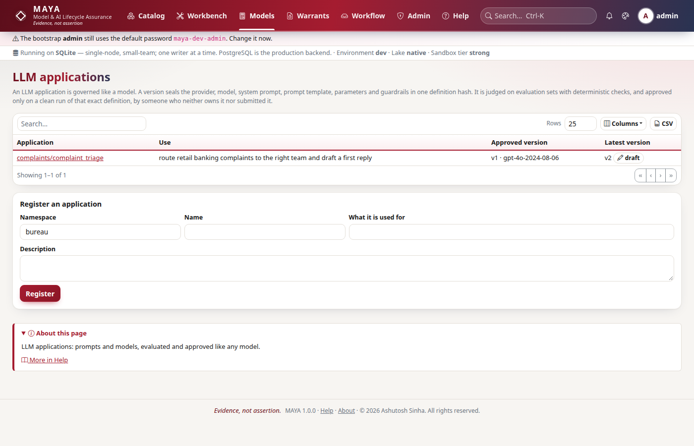

# Tutorial 16 · AI providers, policy and audit

Tutorial 15 used AI. This tutorial is about controlling it. Every AI call in
MAYA goes through one gateway: it picks the model from a profile, checks the
caller's role, the rate and the day's budget, masks personal data out of the
prompt, and records the call in the audit chain. Refusals are recorded too.
And MAYA's own AI features are registered as LLM applications, so they are
evaluated and approved like any application a firm builds. In this tutorial an
administrator sets up providers, reads the policy, watches it refuse, checks
what leaves MAYA, reads the usage, and has MAYA's assistant put under review.

## Time to complete

25 minutes.

## Before you start

- [Tutorial 15 · AI in MAYA: ask, explain and draft](/help/guides/tutorial-15-ai-in-maya):
  the `tutorial-mock` profile, set as the default.
- [Tutorial 14](/help/guides/tutorial-14-llm-applications) explains LLM
  applications, evaluation sets and recorded runs.
- The admin password. No provider key: nothing here calls a provider outside
  this machine.

## What you will learn

- Which providers MAYA offers, and what a profile for each needs.
- Why a key never goes into a profile, and where it goes instead.
- How to test a profile's connection.
- The AI policy: which roles may use which feature, the rate limits, the daily
  token cap and the spending cap.
- What masking removes from a prompt before it leaves MAYA.
- How refusals and completions are audited, and how to read the usage.
- How MAYA's own AI features are governed as LLM applications.

## Step 1 · Reconnect, and list the providers

```python
# reconnect; the providers on offer
import json
import os
import tempfile

import yaml

import maya.sdk as maya

URL = os.environ.get("MAYA_URL", "http://127.0.0.1:8600")
PW = "Tutorial-pass-1"


def key_for(user, password=PW):
    """Sign in and create an API key for that person."""
    token = maya.Client(URL).auth.login(user, password)["token"]
    return maya.Client(URL, token=token).auth.create_api_key("tutorial")["api_key"]


def connect_as(user, password=PW):
    """Sign in, create an API key, and return a client acting as that person."""
    return maya.connect(base_url=URL, api_key=key_for(user, password))


admin = connect_as("admin", "maya-dev-admin")  # your admin password, if you changed it
mona, mick, mgr = connect_as("mona"), connect_as("mick"), connect_as("mgr")

providers = admin.ai.status()["providers"]
print(len(providers), "providers:", ", ".join(p["name"] for p in providers))
```

You should see every provider MAYA ships:

```text
21 providers: anthropic, azure_openai, bedrock, cohere, deepseek, fireworks, gemini, groq, huggingface, lmstudio, mistral, mock, none, ollama, openai, openrouter, perplexity, stub, together, vllm, xai
```

Each has an example profile in `config/ai/`, one file per profile, such as
`config/ai/openai.yaml.example`. Copy one, dropping `.example`, to switch
it on at start-up, or save a profile from Admin → AI models or the SDK, as here.
What each needs:

| Provider | Needs |
|---|---|
| `anthropic`, `openai`, `gemini`, `cohere`, `mistral`, `deepseek`, `groq`, `xai`, `together`, `fireworks`, `openrouter`, `perplexity`, `huggingface` | a model name and a key, read from the environment variable named in `options.api_key_env` |
| `azure_openai` | the deployment, the endpoint and a key from the environment |
| `bedrock` | the model id and the region; credentials from the AWS environment |
| `ollama`, `lmstudio`, `vllm` | a `base_url` on your own network; nothing leaves it |
| `mock` | `options.rules_file`: offline, free, repeatable |
| `stub`, `none` | nothing: an offline echo for tests, and "no AI" |

## Step 2 · A profile never holds a key

```python
# a key in a profile is refused; the name of an environment variable is not
try:
    admin.ai.save_profile(
        "anthropic",
        provider="anthropic",
        model="claude-opus-5",
        options={"api_key": "sk-ant-not-a-real-key"},
    )
except maya.ValidationFailed as exc:
    print(type(exc).__name__, exc)
admin.ai.save_profile(
    "anthropic",
    provider="anthropic",
    model="claude-opus-5",
    options={"api_key_env": "TUTORIAL_ANTHROPIC_KEY"},
)

# a model on this machine that is not running: the test says so
admin.ai.save_profile(
    "ollama", provider="ollama", model="llama3.1", options={"base_url": "http://localhost:1"}
)
test = admin.ai.test("ollama")
print("ollama test:", test["ok"], "|", test["error"])

for p in admin.ai.status()["profiles"]:
    print(" ", p["name"], p["provider"], "ready:", p["ready"], "| default:", p["is_default"])
```

You should see the key refused, the local model's test fail with the reason,
and the profiles with which is ready and which is the default:

```text
ValidationFailed Options may not hold a secret (api_key): name the environment variable that holds it instead, as api_key_env
ollama test: False | ollama at http://localhost:1/api/chat did not answer: [Errno 111] Connection refused
  default none ready: False | default: False
  anthropic anthropic ready: False | default: False
  ollama ollama ready: True | default: False
  tutorial-mock mock ready: True | default: True
```

A profile is configuration, and configuration is copied, exported and shown on
screens. A key in it would leak with it. So a profile names the environment
variable that holds the key, and the key stays in the server's environment.
`anthropic` is not ready because `TUTORIAL_ANTHROPIC_KEY` is not set. `ready`
for a local server only means it is configured; the **test** is what tells you
it answers. The test is a real call, and is audited like one.

## Step 3 · The policy

```python
# the policy, as Admin → AI models shows it
policy = admin.ai.policy()
for f in policy["features"]:
    print(f"{f['feature']:<10}", ", ".join(f["roles"]))
print(
    "per person per minute:",
    policy["per_user_per_minute"],
    "| per feature per minute:",
    policy["per_feature_per_minute"],
)
print(
    "daily token cap:",
    policy["daily_token_cap"],
    "| daily spending cap (USD):",
    policy["daily_cost_cap_usd"],
)
print("masking patterns:", policy["mask_patterns"], "| masked fields:", policy["mask_fields"])
```

You should see each feature with the roles that may use it, the two rate
limits, the two daily caps, and the masking settings:

```text
draft      admin, feature_designer, model_designer, model_developer
documents  admin, model_designer, model_developer, model_manager, model_owner, model_validator
challenger *
llm_eval   admin, model_designer, model_developer, model_manager, model_validator
ask        *
explain    *
narrate    *
admin      admin
per person per minute: 20 | per feature per minute: 120
daily token cap: 2000000 | daily spending cap (USD): 25.0
masking patterns: True | masked fields: []
```

Every call has a fixed purpose in MAYA's code, and each purpose belongs to a
feature; no endpoint lets a caller choose a more permissive one. `ai.roles.<feature>`
names the roles allowed (`*`: anyone signed in). The rate limits stop a runaway
script before it costs anything. The token cap counts every call. The spending
cap counts only profiles that declare their prices, because MAYA ships no price
table: a built-in price would go stale, and a cap computed from a guess is not
a control. All of these are settings (`ai.rate.per_user_per_minute`,
`ai.daily_token_cap`, `ai.daily_cost_cap_usd`, `ai.mask.fields`, ...).

## Step 4 · Refusals, audited

mick is a feature manager. He may ask and explain, but not draft:

```python
# a role refused, then a rate limit reached
try:
    mick.ai.draft_formula("a straight line through the origin")
except maya.PermissionDenied as exc:
    print(type(exc).__name__, exc)

answered = 0
try:
    for _ in range(25):
        mick.ai.explain("feature", "eq/prices")
        answered += 1
except maya.QuotaExceeded as exc:
    print("answered", answered, "then", type(exc).__name__, exc)

for event in admin.admin.audit(action="ai.denied", limit=2):
    print(
        event["actor"],
        event["action"],
        event["detail"]["feature"],
        "|",
        event["detail"]["reason"][:45],
    )
```

You should see the draft refused by role, twenty explanations answered and the
twenty-first refused, and both refusals in the audit chain, newest first:

```text
PermissionDenied Your roles may not use the AI feature 'draft' (ai.roles.draft: admin, feature_designer, model_designer, model_developer)
answered 20 then QuotaExceeded Too many AI requests from you in the last minute (ai.rate.per_user_per_minute); try again shortly
mick ai.denied explain | Too many AI requests from you in the last min
mick ai.denied draft | Your roles may not use the AI feature 'draft'
```

The rate counts a person's calls across every feature, so running all of them
at once does not get round it. A refusal costs nothing and calls no model, and
it is recorded as `ai.denied`, with who, which feature and why. On screen:
**Admin → Audit**, filtered on `ai.denied`.

## Step 5 · What leaves MAYA: masking

Before a prompt leaves, MAYA replaces e-mail addresses, card numbers that pass
the Luhn check, phone numbers and long runs of digits, and the value of any
field named in `ai.mask.fields`. To see it, the admin points a priced profile
at two rules: one that would answer if the model ever saw the card number, and
one that answers only if it sees MAYA's placeholder:

```python
# a priced mock profile whose rules tell us what the model saw
folder = tempfile.mkdtemp(prefix="maya-ai-")
rules_path = os.path.join(folder, "masking-rules.yaml")
seen = json.dumps(
    {
        "kind": "model",
        "filters": [{"field": "namespace", "op": "eq", "value": "credit"}],
        "order_by": None,
        "limit": 5,
    }
)
rules = {
    "rules": [
        {"match": "4111 1111 1111 1111", "reply": "The model read the card number."},
        {"match": r"\[card\]", "reply": seen},
    ],
    "default": "No rule.",
}
with open(rules_path, "w") as fh:
    yaml.safe_dump(rules, fh)
admin.ai.save_profile(
    "priced-mock",
    provider="mock",
    model="mock-1",
    description="Mock, priced like a real model",
    options={"rules_file": rules_path, "price_in_per_mtok": 3.0, "price_out_per_mtok": 15.0},
)
admin.ai.set_default("priced-mock")

# mona types a card number into a question the parser cannot read
a = mona.ai.ask("is the card 4111 1111 1111 1111 on any account?")
print(a["how"], "|", a["summary"])
row = next(r for r in admin.ai.usage(days=1)["by_profile"] if r["profile"] == "priced-mock")
print(row)
```

You should see the model answer with the query from the placeholder rule, so it
never saw the digits, and the call recorded with one masked value and its cost:

```text
model | 3 models match
{'profile': 'priced-mock', 'calls': 1, 'tokens': 143, 'cost_usd': 0.0006, 'masked': 1}
```

The prompt that left said `[card]` where mona typed the number. The audit
records how many values were masked, never the values, and a hash of the prompt
rather than the prompt. A named field is masked the same way: with
`ai.mask.fields: account_holder`, the text `account_holder: J. Smith` leaves as
`account_holder: [masked]`. This server sets no named fields, so the policy in
step 3 lists none; it is a server setting, not something the SDK changes.

The cost comes from the prices the profile declares (here, dollars per million
tokens in and out), and counts towards `ai.daily_cost_cap_usd`.

## Step 6 · Who used what

```python
# AI use today, by feature, for the administrator
usage = admin.ai.usage(days=1)
print("refused today:", usage["refused"])
for f in usage["by_feature"]:
    print(f"  {f['feature']:<8} {f['calls']:>3} calls  masked {f['masked']}")
print(sorted(admin.ai.policy()["today"]))
```

You should see the two refusals from step 4, every completion today by feature
(from tutorial 14's live run onwards), and the keys of today's totals:

```text
refused today: 2
  explain   22 calls  masked 1
  ask        6 calls  masked 1
  llm_eval   2 calls  masked 0
  draft      2 calls  masked 0
  admin      1 calls  masked 0
  narrate    1 calls  masked 0
['calls', 'cost_usd', 'since', 'tokens']
```

Masking applies to everything in a prompt, records included: the masked value
under `explain` is from the warrant record explained in tutorial 15, which
holds a figure shaped like personal data. The figures are read from the audit
chain's own `ai.completion` and
`ai.denied` entries, so they cannot drift from what happened. `usage` groups
the same entries by person and by profile too; `policy()["today"]` gives the
day's totals that the caps are checked against. On screen all of this is
**Admin → AI models**.

## Step 7 · MAYA governs its own AI

MAYA's own AI features are applications like any other: a system prompt, a
provider and a model, and answers that can be wrong. So they can be registered
as LLM applications and approved on evidence. The admin opens a namespace for
them, and mona registers them:

```python
# a namespace for MAYA's own AI; mona registers the three features in it
admin.namespaces.create("maya_ai", preset="standard")
reg = mona.ai.register_self("maya_ai")
print(reg["provider"], reg["model"], [r["ref"] for r in reg["registered"]])
app = mona.llm.app("maya_ai/maya-ask")
version = app["versions"][0]
print(version["state"], version["provider"], version["model"])
print([(s["name"], len(s["cases"])) for s in app["eval_sets"]])
```

You should see the three applications registered against the default profile's
provider, and `maya-ask` as a draft with its starter evaluation set:

```text
mock mock-1 ['maya_ai/maya-ask', 'maya_ai/maya-explain', 'maya_ai/maya-draft-formula']
draft mock mock-1
[('starter', 2)]
```

Each version carries the feature's real system prompt, so what is reviewed is
what runs. The starter set is a beginning: add the questions your firm asks.
Now evaluate it. MAYA does not call a mock provider's rules for a declared
pairing, so this is a **recorded run**, with answers collected from the model
in use:

```python
# a recorded run of maya-ask's starter set, then submission and approval
answers = {
    "approved-models": json.dumps(
        {
            "kind": "model",
            "filters": [
                {"field": "latest_state", "op": "eq", "value": "approved"},
                {"field": "namespace", "op": "eq", "value": "credit"},
            ],
            "order_by": None,
            "limit": 50,
        }
    ),
    "no-sql": json.dumps({"kind": "model", "filters": [], "order_by": None, "limit": 5}),
}
run = mona.llm.run_eval("maya_ai/maya-ask", 1, "starter", responses=answers)
print(
    run["mode"],
    run["passed"],
    "of",
    run["cases"],
    "passed;",
    run["guardrail_violations"],
    "guardrail violations",
)
print(mona.llm.submit("maya_ai/maya-ask", 1)["state"])
r = mgr.llm.decide("maya_ai/maya-ask", 1, "approve", "Starter cases pass; no SQL, no personal data")
print(r["state"], "by", r["decided_by"])
```

You should see both starter cases pass, the version submitted, and mgr's
approval:

```text
recorded 2 of 2 passed; 0 guardrail violations
in_review
approved by mgr
```

From here MAYA's assistant is governed like everything else in the estate: a
change to its prompt or its model is a new version, evaluated and approved
before anyone relies on it.



## Next steps

- [Documents and AI](/help/documents) lists every AI setting and feature.
- [LLM applications](/help/llm-apps) covers evaluation sets, guardrails and
  approval in full.
- [Security](/help/security#audit) explains the audit chain the refusals and
  completions are written to.

## If something goes wrong

| What you see | Why | What to do |
|---|---|---|
| `Options may not hold a secret` | A key was put in a profile's options | Put the key in the server's environment; name the variable in `api_key_env` |
| A profile is `ready` but its test fails | `ready` means configured, not reachable | Read the test's error; check the address, the key's variable, the network |
| `Your roles may not use the AI feature ...` | The feature's `ai.roles.<feature>` excludes your roles | Ask an administrator, or use a feature your role allows |
| `Too many AI requests from you in the last minute` | `ai.rate.per_user_per_minute` was reached | Wait a minute; scripts should pace their calls |
| `Today's AI token budget ... is spent` | `ai.daily_token_cap` was reached | It resets at midnight UTC; an administrator may raise it |
| `Choose a default AI profile first` on `register_self` | The default profile has no provider | Set a default, as tutorial 15 does |
